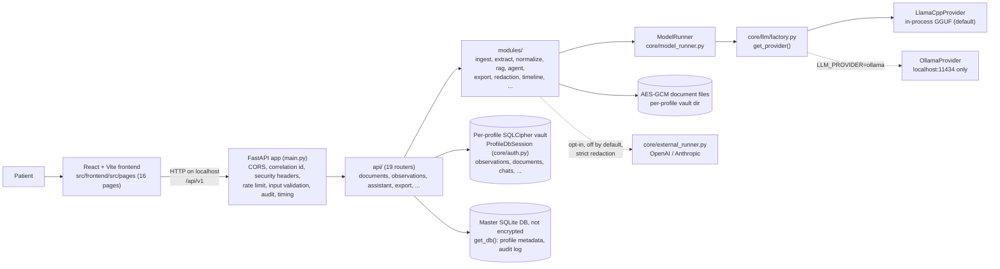
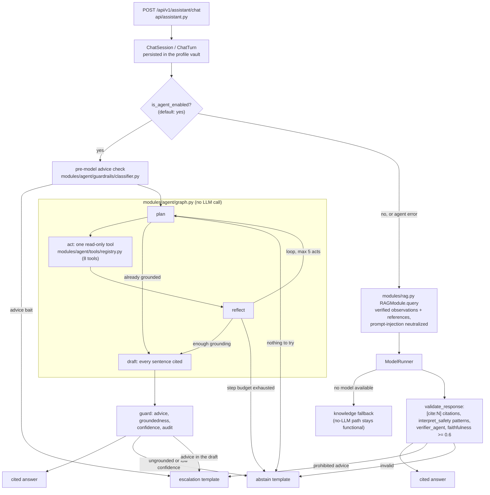
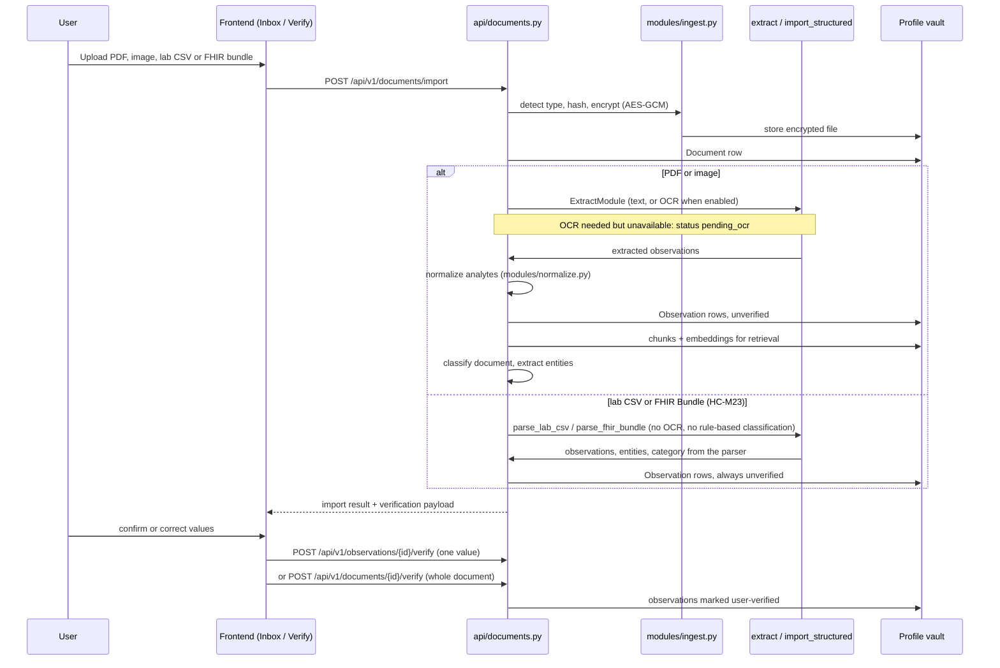
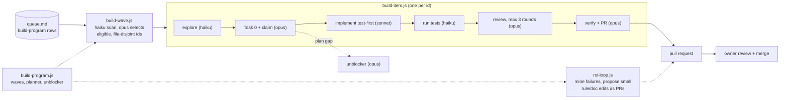

# Asclexis

**Local-First Medical Results Companion**

A privacy-first desktop application for patients to import medical documents, extract structured information with user verification, visualize trends, and generate grounded explanations with citations.

> **Research and educational open-source project. Not professional medical or legal advice, not a medical device, and not for emergencies.** See [Disclaimer](#disclaimer).

## Overview

Asclexis helps patients:
- **Import** lab PDFs, images, and CSV/FHIR R4 exports from other systems into an encrypted local vault
- **Extract & Verify** structured data with human-in-the-loop verification. Everything extracted lands unverified until the user confirms it; structured (CSV/FHIR) imports are no exception, and medication mentions become reconciliation suggestions, never direct changes to the medication list
- **Visualize** longitudinal trends with reference-range context; unverified points are labelled as such
- **Understand** results through a read-only assistant that answers with citations, including bounded questions about open care tasks, medication changes, and the record timeline
- **Export** doctor-ready summaries, discussion prompts, and a verified-only, redacted FHIR R4 bundle

## Core Principles

- **Local-first.** The app, its databases, and model inference run on the user's machine. The Ollama provider is pinned to localhost. The only outbound paths are user-initiated: model downloads, and an opt-in external LLM runner that is off by default and strictly redacted (see [Privacy boundaries](#privacy-boundaries)).
- **Encrypted at rest.** Each profile has its own SQLCipher vault and AES-GCM document store. Encryption is required by default (`DATABASE_ENCRYPTION_REQUIRED`); a dev setup without SQLCipher runs unencrypted and must not hold real data.
- **Grounded outputs.** Assistant answers cite the user's records or curated references, or abstain.
- **Conservative behavior.** "Insufficient information" is preferred over speculation; abstain and escalate are first-class outcomes.
- **No medical advice.** Education only: no diagnosis, dosing, or treatment recommendations. Prohibited-advice patterns are checked before an answer is shown.
- **Compliance posture.** The project is designed as if HIPAA applied (owner choice, 2026-09-27). That is a design posture, not a compliance claim or certification. See [`docs/compliance/`](docs/compliance/README.md).

## Architecture

Four diagrams below give the shape of the system. The full hand-maintained set
(request lifecycle and middleware chain, module dependency direction, the
dual-database and dual-migration data architecture, frontend structure, the
safety and privacy control-flow, and CI gates) lives in
**[`docs/architecture/`](docs/architecture/README.md)**, alongside a
[performance & scalability review](docs/architecture/performance-scalability-review.md).
Paths below are relative to `src/backend/` unless they start with `src/`.

### System overview



All feature-code inference goes through `ModelRunner`. The single named
exception is the opt-in external runner (owner decision D12), which applies
`strict` redaction on every call; break-glass is the only bypass and writes an
audit record. Patient data is only read through `ProfileDbSession`; the master
DB holds profile metadata and the audit log.

### Assistant chat: agent path and legacy RAG path



The agent path is the default (`modules/agent/settings.py`); a per-profile flag
switches back to single-shot RAG. On the legacy path, `[cite:N]` is the
validated citation marker; `[YOUR_RESULTS:N]` and `[REFERENCE:N]` are context
labels only. Details: [`docs/architecture/pipelines.md`](docs/architecture/pipelines.md).

### Document to observations



Undated observations are listed but excluded from time series; `POST
/documents/{id}/reprocess` re-extracts (except for CSV/FHIR imports, which
have no text to rebuild from).

### Build-program agent workflow (contributors)

Most recent work in this repository is planned and built by Claude Code agents
following [`docs/plans/2026-10-15-build-program/RUNBOOK.md`](docs/plans/2026-10-15-build-program/RUNBOOK.md),
sequenced by the workflow scripts in `.claude/workflows/`. A human owner
records decisions and merges.



Per-phase model routing is in the workflow scripts' `meta` blocks and
[`docs/agentic/orchestration.md`](docs/agentic/orchestration.md); behavioral
rules and the definition of done are in [`CLAUDE.md`](CLAUDE.md) and
[`AGENT.md`](AGENT.md).

### Privacy boundaries

- **Exports that leave the app pass through `modules/redaction.py` first:** the
  doctor summary (strict), FHIR R4 bundle, visit-prep packets, and the RL
  feedback dataset. `GET /export/csv` and `GET /export/json` are the patient's
  own full-fidelity export and are deliberately not redacted (owner decision D3).
- **Backups are unredacted by design** (a redacted backup cannot be restored)
  and are profile-scoped.
- **Audit logging** covers routes that touch documents, observations, or profile
  data. The audit log lives in the unencrypted master DB, so its rows are
  minimized (AUDIT-PHI-001).

## Technology Stack

- **Backend**: Python 3.11+, FastAPI, SQLAlchemy, Alembic (separate master and profile chains)
- **Databases**: SQLite master DB plus per-profile SQLCipher vault DBs
- **Document vault**: AES-GCM encrypted files under per-profile vault directories
- **Retrieval**: per-profile embedding blobs scanned with a linear cosine-similarity pass (no external vector index at single-user scale), plus curated reference content seeded at startup
- **Local LLM**: llama-cpp-python with GGUF models (default), or Ollama on localhost
- **Embeddings**: `sentence-transformers/all-MiniLM-L6-v2`, fetched once and loaded offline (`modules/embeddings.py`)
- **Optional external LLMs**: OpenAI/Anthropic runner, opt-in, strict redaction (`core/external_runner.py`)
- **Frontend**: React + Vite + TypeScript, Tailwind, React Router, TanStack Query, Zustand

### Scalability posture

The meaningful scaling axis here is **one person's record growing over years**,
not concurrent users; this is a local-first desktop application by design.
Known limits (search rebuilds its FTS index per query, a few generated-export
stores are in memory without a TTL, LLM inference is in-process and blocking)
and what this system deliberately does *not* need are written up in
[`docs/architecture/performance-scalability-review.md`](docs/architecture/performance-scalability-review.md).

## Documentation Source of Truth

1. `README.md` (this file — repo entrypoint)
2. `docs/api/endpoints.md` (exact mounted API route inventory and auth requirements)
3. `docs/00_architecture_plans_index.md` (full documentation index; see also `docs/roles/00_roles_index.md` for a domain-based entry point)
4. `docs/features/TASK_LIST.md` (active remaining-work tracker)
5. `docs/05_backend_integration_status.md` (Historical Reference — Sprint 06 snapshot retained for audit context only)

Backend detail: [`docs/01_backend_architecture_plan.md`](docs/01_backend_architecture_plan.md)
and [`docs/roles/backend-api.md`](docs/roles/backend-api.md). A flat map of every
doc is generated at [`docs/INDEX.md`](docs/INDEX.md).

Docs gates (also run in CI): `python3 scripts/generate_docs_index.py && python3 scripts/docs_lint.py --link-graph`
regenerates the index and link graph, and `python3 scripts/docs_lint.py` checks ownership fields,
required sections, canonical-order consistency, links, orphans, and historical banners.

## Getting Started

### Prerequisites
- Python 3.11+
- Node.js 22.12+ (Node.js 24 LTS recommended)
- Browser: Safari 16.4+, Chrome 111+, Firefox 128+
- Optional: Tesseract and Poppler (`pdftoppm`) for OCR of scanned documents

### Quick Start (Windows, `dev.ps1`)

Windows is the native development environment. From the repository root:

```powershell
.\dev.bat        # one-click launcher
.\dev.ps1        # or run the PowerShell script directly
```

`dev.ps1`:
- checks for Python and Node.js;
- creates the backend virtual environment at `src/backend/venv` if needed and installs `requirements.txt`. **If `sqlcipher3-binary` cannot be installed, it installs the rest, sets `DATABASE_ENCRYPTION_REQUIRED=false` in `src/backend/.env` and warns: profile databases are then unencrypted, so do not use real data** (see [SQLCipher Setup](#sqlcipher-setup));
- runs `npm ci` when `src/frontend/package-lock.json` changes;
- creates the data directory structure and `.env`;
- resolves the next free backend/frontend ports if 8000/3000 are busy and syncs `src/frontend/.env.local` with the resolved API URL;
- starts both servers and opens the browser.

Default URLs: frontend http://localhost:3000, backend http://localhost:8000
(`/docs` serves the interactive API docs when `DEBUG=true`). If a port is busy,
use the URLs `dev.ps1` prints. `Ctrl+C` stops both servers.

### Quick Start on WSL/Linux (`dev.sh`)

Clone into your Linux home (for example `~/HealthCentral`), **not** under `/mnt/c`: the Windows mount is slow, file watching is unreliable, and Windows and Linux cannot share the venv or `node_modules`. `dev.sh` refuses to run from `/mnt/*` unless `HC_ALLOW_WINDOWS_MOUNT=1` is set.

```bash
git clone <repo-url> ~/HealthCentral && cd ~/HealthCentral
./dev.sh
```

It mirrors `dev.ps1`, with these differences:
- Uses its own venv at `src/backend/.venv-linux` (never the Windows `src/backend/venv`).
- Never installs system packages; it prints an install hint when Python 3.11+, Node.js 22.12+, `tesseract` or `pdftoppm` is missing.
- Picks the next free port when 8000/3000 are busy, but does not stop the process holding them.
- Binds both servers to `127.0.0.1`, writes `logs/dev-backend.log` and `logs/dev-frontend.log`, does not open a browser and does not restart a crashed server.

### Model setup

The app works without any model: the assistant falls back to a no-LLM
knowledge path, and the agent path makes no model call. A local model enables
the legacy RAG explainer and model-backed interpretations. Run these from
`src/backend` (`scripts/download_models.py`):

```bash
python scripts/download_models.py list                   # tiers, RAM/disk needs, download status, Ollama tags
python scripts/download_models.py auto                   # download the tier recommended for this hardware
python scripts/download_models.py download --tier mid    # or a specific tier (low, mid, high, gemma4-*)
python scripts/download_models.py embedding              # one-time fetch of the embedding bundle (needed for retrieval)
python scripts/download_models.py nli                    # optional: NLI cross-encoder (HC-M11, flag-gated)
```

- **llama.cpp (default).** `LLM_PROVIDER=llama_cpp` loads GGUF files from
  `models/` in-process. The Gemma 4 tier repos are marked as placeholders in
  `download_models.py`; `python scripts/download_models.py verify` checks every
  tier repo exists on Hugging Face (needs network).
- **Ollama.** Set `LLM_PROVIDER=ollama` and `LLM_MODEL` (for example
  `gemma4:12b`), and pull the model with
  `ollama pull <tag>` or `python scripts/download_models.py ollama --tag <tag>`.
  The provider connects to the local default `127.0.0.1:11434`, and switching
  provider in Settings rejects a non-localhost `OLLAMA_BASE_URL`. If the daemon
  is unreachable the factory falls back to llama.cpp. The provider
  can also be switched in Settings (`PUT /api/v1/settings/model/provider`).
- **Embedding bundle.** The pinned `all-MiniLM-L6-v2` revision is fetched once,
  sha256-checked per file, and loaded with `local_files_only=True`; the backend
  never downloads it at runtime and fails closed if it is absent. Without it,
  exactly 5 backend tests fail (see [AGENT.md](AGENT.md#commands-windows-is-the-native-dev-environment)).

Configuration lives in `src/backend/.env`, created from
[`config/.env.example`](config/.env.example).

### SQLCipher Setup

Each profile database is an AES-256 SQLCipher database. `sqlcipher3-binary`
(in `requirements.txt`) ships pre-built wheels; on Debian/Ubuntu install
`libsqlcipher-dev` first if the wheel fails to build, and on macOS
`brew install sqlcipher`. Verify with:

```python
import sqlcipher3
print(sqlcipher3.connect(":memory:").execute("PRAGMA cipher_version").fetchone())  # ('4.x.x',)
```

`DATABASE_ENCRYPTION_REQUIRED=false` in `.env` allows unencrypted profile
databases for development only. **Never use it with real data.**

### Database migrations

Two independent Alembic chains: `migrations/master/` (profiles, audit log,
knowledge base) and `migrations/profile/` (each SQLCipher vault). Master
migrations run on startup; profile migrations run when a vault is opened.
Databases without `alembic_version` are stamped, not migrated. Manual use, from
`src/backend`:

```bash
python -m scripts.migrate master                          # master chain
python -m scripts.migrate status                          # migration status
python -m scripts.migrate profile --profile-id <uuid>     # one profile (prompts for its password)
```

### Running tests

```bash
# Backend (from src/backend)
python -m pytest tests/ -p no:cacheprovider -q

# Frontend (from src/frontend)
npx tsc --noEmit
npx vitest run
npx playwright test --project chromium       # e2e, as CI runs it

# Eval gates, docs and hygiene (from the repo root, as CI runs them)
python3 scripts/agent_eval_gate.py           # CI: Agent Eval Gate
python3 scripts/legacy_eval_gate.py          # CI: Legacy RAG Eval Gate
python3 scripts/docs_lint.py
python3 scripts/repo_hygiene_check.py
```

The current collected-test baseline and the known environment-only failures
are recorded in [`AGENT.md`](AGENT.md#commands-windows-is-the-native-dev-environment);
the full definition of done is in [`AGENT.md`](AGENT.md#definition-of-done).
On WSL with a Windows-mounted checkout, clear `__pycache__` before pytest and
prefer running the frontend toolchain on Windows. The contributor proof bundle
is in [`CONTRIBUTING.md`](CONTRIBUTING.md).

### Supported Local Verification Bootstrap (WSL/Linux)

Creates the repo-root verifier environment that the contributor proof bundle
expects. Run from the repository root, with a venv created by the WSL/Linux
interpreter (never activate a Windows-created venv from `/mnt/c/...`):

```bash
python3 -m venv .wsl-pytest-venv
./.wsl-pytest-venv/bin/python -m pip install --upgrade pip
./.wsl-pytest-venv/bin/python -m pip install -r src/backend/requirements.txt
npm --prefix src/frontend install

python3 scripts/docs_lint.py
npx --prefix src/frontend tsc --noEmit -p src/frontend/tsconfig.json
PYTHONPATH=src/backend ./.wsl-pytest-venv/bin/python -m pytest src/backend/tests/test_bootstrap_check.py -q
```

`.wsl-pytest-venv/` and `.bg-shell/` are local-only and gitignored. If
`sqlcipher3-binary` fails to install on Debian/Ubuntu, install
`libsqlcipher-dev` first. OCR-heavy tests and features also need
`tesseract-ocr` and Poppler; the bootstrap smoke test does not.

### Full UI verification (optional)

The manual sweep in
[`src/frontend/e2e/BROWSER_MCP_PLAYBOOK.md`](src/frontend/e2e/BROWSER_MCP_PLAYBOOK.md),
and the real-PDF Playwright project (`--project real-pdf-local`, set
`HC_E2E_REAL_PDF`; see
[`src/frontend/e2e/ui-full-verification.spec.ts`](src/frontend/e2e/ui-full-verification.spec.ts)).

### Manual development

```bash
# Terminal 1: backend (from src/backend, inside its venv)
uvicorn main:app --reload --host 127.0.0.1 --port 8000

# Terminal 2: frontend (from src/frontend)
npm run dev
```

## Project Structure

```
HealthCentral/
├── AGENT.md, CLAUDE.md        # contributor and agent briefing, behavioral rules
├── dev.ps1, dev.bat, dev.sh   # one-command dev launchers (Windows, WSL/Linux)
├── config/                    # .env.example
├── docs/                      # architecture, API, user, compliance, plans, reviews, archive
├── scripts/                   # docs lint/index, hygiene, eval and security gates
├── skills/                    # project domain skills (agent, guardrails, backend, evals)
├── .claude/                   # vendored process skills, agents, build-program workflows
└── src/
    ├── backend/
    │   ├── main.py            # app factory, middleware, router mount
    │   ├── api/               # FastAPI routers
    │   ├── core/              # config, auth, db, audit, time, ModelRunner, llm/ providers
    │   ├── models/            # SQLAlchemy models
    │   ├── modules/           # feature logic (ingest, extract, rag, agent/, redaction, ...)
    │   ├── migrations/        # master/ and profile/ Alembic chains
    │   ├── monitoring/        # metrics, correlation ids, timing
    │   ├── security/          # input validation, rate limiting, headers
    │   ├── scripts/           # backup, migrate, download_models, seed knowledge
    │   └── tests/             # pytest suites (incl. agent/ golden evals)
    └── frontend/
        ├── src/               # pages/, components/, services/, stores/
        └── e2e/               # Playwright specs
```

`data/` and `models/` are created locally and gitignored.

## API Overview

Asclexis exposes a REST API via FastAPI at `http://localhost:8000/api/v1`. The
exact path-level **source of truth** is [docs/api/endpoints.md](docs/api/endpoints.md).

| Group | Endpoints | Description |
|-------|-----------|-------------|
| **Profiles** | `/profiles/` | Create, list, log in to, unlock, lock, recover, and delete encrypted profiles |
| **Documents** | `/documents/` | Import PDFs/images or CSV/FHIR files (always unverified), list, classify, entities, page images, reprocess, delete |
| **Observations** | `/observations/` | List, verify, trends, panel grouping |
| **Interpretations** | `/interpretations/` | Observation and panel interpretation, biomarker knowledge lookup |
| **Assistant** | `/assistant/` | Chat with citations (agent path by default), sessions, glossary, verification status |
| **Memory** | `/memory/` | Assistant memory CRUD per profile |
| **Medications** | `/medications/` | CRUD, schedules, dose logging, adherence stats, pattern learning |
| **Gamification** | `/gamification/` | Badges and streak summaries |
| **Notifications** | `/notifications/` | Reminder settings, history, test sends, scheduler status |
| **Export** | `/export/` | CSV/JSON export, doctor summary, discussion questions, verified-only redacted FHIR R4 bundle |
| **Model Settings** | `/settings/model` | Model tier, provider, downloads, external API, timezone, voice, OCR, agent toggle, diagnostics |
| **Care Tasks** | `/care-tasks/` | Care-plan tasks, candidates derived from a document, accept, status updates |
| **Timeline** | `/timeline/` | Chronological view of the record, derived on read |
| **Med Reconciliation** | `/med-reconciliation/` | Compare a document's medication mentions with the medication list (read-only) |
| **Pinboards** | `/pinboards/` | Pinboards, items, and visit-prep packets |
| **Search** | `/search/` | Bounded local search over documents, entities, and observations |
| **Backup** | `/backup/` | Create, list, verify, download, restore, prune per-profile backups; schedule |
| **Feedback** | `/feedback/` | Per-turn ratings/corrections, stats, redacted preference-dataset export |
| **Data Donation** | `/donation/` | Opt-in donation consent per purpose; revoke deletes donated rows |
| **Monitoring** | `/health`, `/monitoring/` | Public liveness probe and authenticated metrics |

`docs/05_backend_integration_status.md` is a **Historical Reference** (Sprint 06 snapshot), not the live API tracker.

## Documentation

- **Users:** [Getting Started](docs/user/getting-started.md) · [Workflows](docs/user/workflows.md) · [Troubleshooting](docs/user/troubleshooting.md) · [FAQ](docs/user/faq.md)
- **Developers:** [API docs](docs/api/README.md) · [Live endpoints](docs/api/endpoints.md) · [Architecture diagrams](docs/architecture/README.md) · [Roles index](docs/roles/00_roles_index.md) · [Documentation index](docs/00_architecture_plans_index.md) · [Recurring failure modes](docs/agentic/recurring-failures.md)
- **Compliance & operations:** [HIPAA controls](docs/compliance/hipaa-controls.md) · [Data privacy](docs/compliance/data-privacy.md) · [Disaster recovery](docs/compliance/disaster-recovery.md) · [Audit checklist](docs/compliance/audit-checklist.md)
- **Agent overhaul (shipped):** the read-only plan→act→reflect agent under `src/backend/modules/agent/` replaced single-shot RAG as the default chat path. PRD: [PRD_agent_overhaul.md](docs/prd/PRD_agent_overhaul.md); process: [AGILE_PLAN](docs/agile/AGILE_PLAN.md) · [RELEASE_CHECKLIST](docs/agile/RELEASE_CHECKLIST.md); completed phase and sprint records are under [`docs/archive/`](docs/archive/README.md). Its 74 golden eval cases live in `src/backend/tests/agent/golden/`, gated by `scripts/agent_eval_gate.py`. Domain skills: [asclexis-agent](skills/asclexis-agent/SKILL.md) · [asclexis-guardrails](skills/asclexis-guardrails/SKILL.md) · [asclexis-backend](skills/asclexis-backend/SKILL.md) · [asclexis-evals](skills/asclexis-evals/SKILL.md).

## Implementation Progress

See [docs/features/TASK_LIST.md](docs/features/TASK_LIST.md) for the active remaining-work tracker, and the build-program [queue](docs/plans/2026-10-15-build-program/queue.md) for agent-run work items.

## License

[TBD]

## Disclaimer

This application is for informational and educational purposes only. It does not provide medical advice, diagnosis, or treatment recommendations. Always consult with qualified healthcare professionals for medical concerns.

- **Research and educational project.** Asclexis is open-source software for people curious about their own health and fitness records who want to track them in one place and build personal software on top of them. It is a research study, not a clinical product.
- **Not professional medical or legal advice.** Nothing it shows, summarizes, or exports is medical advice or legal advice. Talk to a qualified professional before acting on anything it displays.
- **Not a medical device.** It is not cleared or approved by any regulator, and it is not intended to diagnose, treat, cure, monitor, or prevent any disease or condition.
- **Not for diagnosis, treatment, or emergencies.** Do not use it to make treatment decisions. In an emergency, contact your local emergency number.
- **Your data, your risk.** You run it on your own device, with your own data, at your own risk. The software is provided as is, without warranty of any kind.
