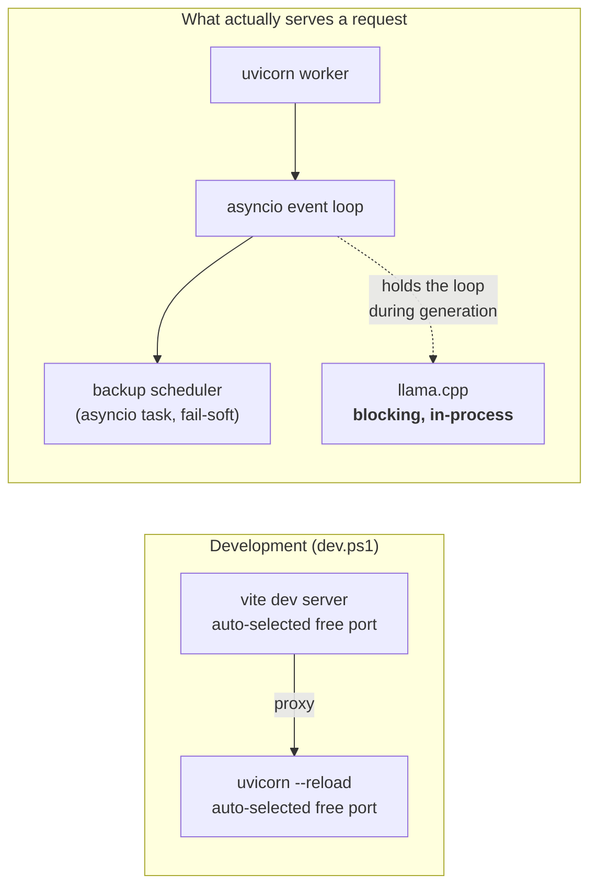

# Architecture Diagrams

**Last Updated:** 2026-11-06 (DOCS-AUDIT-1106: 17 pages, router count, `model_selector` reachability, master-DB contents, where-to-find table)
**Owner:** Project Lead
**Refresh Trigger:** A new router, module, database, migration chain, or CI job is added or removed

Hand-authored mermaid diagrams of the running system, kept here so the whole
structure can be reviewed in one place. Mermaid rather than image files on
purpose: diagrams render on GitHub, and they diff line-by-line when the code
they describe changes.

These describe **what exists**, not what is planned. Where a diagram shows a
known weakness it says so rather than drawing the idealised version — the point
of this set is to support the
[performance & scalability review](performance-scalability-review.md).

| Diagram | What it answers |
|---|---|
| [System overview](overview.md) | What the product does, core principles, README-level diagrams, privacy boundaries, stack, project structure |
| [System context & topology](#system-context) | What processes run, what talks to what, where the network boundary is |
| [Backend structure](backend.md) | Request lifecycle, module dependencies, data architecture |
| [Pipelines](pipelines.md) | Document → insight, assistant/agent graph, safety control-flow |
| [Frontend](frontend.md) | Pages, services, state |
| [CI & quality gates](ci-and-quality-gates.md) | What blocks a merge |
| [Performance & scalability review](performance-scalability-review.md) | Where this breaks as data grows |

## Where to find X

Paths are relative to the repository root.

| Looking for | Start here |
|---|---|
| App factory, middleware order, router mounts, startup order | `src/backend/main.py` · [backend.md](backend.md#request-lifecycle) |
| Router list and URL prefixes | `src/backend/api/__init__.py` · [`docs/api/endpoints.md`](../api/endpoints.md) |
| Auth dependencies (`RequireAuth`, `ProfileDbSession`, `require_profile_access`) | `src/backend/core/auth.py` |
| Master DB / per-profile SQLCipher vault | `src/backend/core/database.py` · `src/backend/core/profile_database.py` |
| Alembic runners and chains | `src/backend/core/migrations.py` · `src/backend/migrations/{master,profile}/versions/` · [backend.md](backend.md#data-architecture) |
| Audit rows and the PHI allowlist | `src/backend/core/audit.py` |
| Local inference facade and providers | `src/backend/core/model_runner.py` · `src/backend/core/llm/` |
| Opt-in cloud runner (D12) | `src/backend/core/external_runner.py` |
| Document import pipeline | `src/backend/api/documents.py::import_document` · `src/backend/modules/ingest.py` · [pipelines.md](pipelines.md#document--insight) |
| Assistant chat (agent and legacy) | `src/backend/api/assistant.py::chat` · `src/backend/modules/agent/graph.py` · `src/backend/modules/rag.py` · [pipelines.md](pipelines.md#assistant--agent-graph) |
| Agent tools and guardrails | `src/backend/modules/agent/tools/registry.py` · `src/backend/modules/agent/guardrails/` |
| Safety and privacy modules (ask first) | `src/backend/modules/{interpret_safety,redaction,faithfulness,verifier_agent}.py` |
| Exports and their redaction | `src/backend/api/export.py` · `src/backend/modules/export.py` · `src/backend/modules/fhir_export.py` · `src/backend/modules/rl_dataset.py` |
| Backups and schedulers | `src/backend/api/backup.py` · `src/backend/scripts/backup.py` · `src/backend/modules/backup_scheduler.py` · `src/backend/modules/notification_scheduler.py` |
| SQLAlchemy models | `src/backend/models/` |
| HTTP middleware | `src/backend/security/` · `src/backend/monitoring/` |
| Frontend routes | `src/frontend/src/App.tsx` · [frontend.md](frontend.md#routes-and-pages) |
| Nav names, sidebar groups, phone tab bar | `src/frontend/src/components/layout/navConfig.ts` · [frontend.md](frontend.md#shell-and-navigation) |
| Frontend API client and hooks | `src/frontend/src/services/` |
| CI jobs | `.github/workflows/ci.yml` · [ci-and-quality-gates.md](ci-and-quality-gates.md) |
| Repo scripts (docs lint, gates, pyslot) | `scripts/` |
| Dev launchers | `dev.ps1` / `dev.bat` (Windows) · `dev.sh` (WSL/Linux) · [`docs/dev/setup.md`](../dev/setup.md) |
| Agent workflows, agents, skills | `.claude/workflows/` · `.claude/agents/` · `.claude/skills/` · `skills/` |
| Agent golden evals | `src/backend/tests/agent/golden/` · `scripts/agent_eval_gate.py` |

Authority: these diagrams sit **below** [`CLAUDE.md`](../../CLAUDE.md),
[`AGENT.md`](../../AGENT.md) and the canonical docs indexed by
[`docs/00_architecture_plans_index.md`](../00_architecture_plans_index.md). If a
diagram disagrees with those, they win and the diagram is stale.

---

## System context

The whole product runs on one machine. There is no server tier, no sync
service, and no telemetry — the only "remote" thing in the picture is an
optional model download the user explicitly triggers.

```mermaid
graph TB
    subgraph device["🖥️ User's device — everything below is local"]
        subgraph browser["Browser / desktop shell"]
            UI["React + Vite frontend<br/>17 pages, React Query + Zustand"]
        end

        subgraph backend["FastAPI backend (uvicorn)"]
            API["19 domain routers under /api/v1<br/>+ /health (root) and /api/v1/monitoring/metrics"]
            MOD["modules/ — feature logic"]
            CORE["core/ — config, auth, db, time, llm"]
            MR["ModelRunner facade<br/><i>entry point for local inference</i>"]
        end

        subgraph storage["Storage"]
            MASTER[("Master DB — SQLite<br/><b>NOT encrypted</b><br/>profile metadata + audit log")]
            VAULT[("Per-profile vaults — SQLCipher<br/><b>encrypted</b><br/>vault.db + key.bin + key.recovery.bin + docs/")]
            BACKUPS[("backups/&lt;profile_id&gt;/<br/>snapshots + sha256 manifest")]
            MODELS[("models/ — GGUF artifacts<br/>SHA256-pinned where available")]
        end

        subgraph llm["Local inference"]
            LCPP["LlamaCppProvider<br/>in-process, default"]
            OLLAMA["OllamaProvider<br/>localhost:11434 only"]
        end
    end

    HF["🌐 Hugging Face"]

    UI -->|"HTTP, localhost"| API
    API --> MOD --> CORE
    MOD --> MR
    MR --> LCPP
    MR -.->|"if configured"| OLLAMA
    LCPP --> MODELS
    CORE --> MASTER
    CORE --> VAULT
    CORE --> BACKUPS
    HF -.->|"explicit, user-initiated<br/>model download only"| MODELS

    classDef encrypted fill:#1b5e20,stroke:#66bb6a,color:#fff
    classDef plain fill:#b71c1c,stroke:#ef5350,color:#fff
    classDef external fill:#37474f,stroke:#90a4ae,color:#fff,stroke-dasharray: 5 5
    class VAULT encrypted
    class MASTER plain
    class HF external
```

**Read the colours.** The green store is SQLCipher-encrypted; the red one is
not. That asymmetry is the single most important fact about this system's
privacy posture, and it is why
[AUDIT-PHI-001](../compliance/hipaa-controls.md) minimizes what audit rows may
contain — the audit log is the main patient-linked dataset living outside the
encryption boundary (the others are the profile row itself, with display name
and password hash in `models/profile.py`, and the id-and-schedule-only
`backup_schedules` rows).

The dashed Hugging Face edge is a model download the user chooses in Settings.
Two other outbound paths exist in code, both user-initiated:

- **Embedding model, one-time fetch.** Owner decision D8 (2026-09-27): no
  runtime download. Since work item W-8, `src/backend/scripts/download_models.py
  embedding` fetches the pinned `sentence-transformers/all-MiniLM-L6-v2`
  revision once (sha256-checked per file), and `modules/embeddings.py` loads it
  only from the local directory with `local_files_only=True`, failing closed if
  it is absent. The runtime never contacts Hugging Face for it. An installer
  that bundles it is later work (G-C4).
- **Opt-in cloud LLM.** `core/external_runner.py` can call OpenAI or Anthropic
  when the user enables the external API (off by default). It does not go
  through `ModelRunner`. Owner decision D12 (2026-09-27) keeps it as a
  documented exception. Strict redaction is now unconditional; break-glass
  (`EXTERNAL_API_REDACTION_BREAK_GLASS`) is the only way to weaken it, writes
  an audit record, and shows a warning in Settings and on the assistant chat
  page (work item W-6). `CLAUDE.md` names the exception (§3 and Hard
  invariants, D12).

`ModelRunner` is the entry point for local inference. One dormant path bypasses
it: `ModelSelector.load_model` in `modules/model_selector.py` imports
`llama_cpp` directly. Its only non-test chain is
`InterpretModule.interpret_with_model` → `get_model_for_inference` →
`load_model_async` → `load_model`, and no route calls `interpret_with_model`
at this revision. Owner decision D7 routes it
through `ModelRunner` (work item W-7, not yet implemented). `OllamaProvider` is
pinned to localhost by design; see [`CLAUDE.md`](../../CLAUDE.md) hard
invariants. All decisions: [owner-decisions-2026-09-27.md](../capstone-report/owner-decisions-2026-09-27.md).

## Process topology

Two background tasks start with the app: the **backup scheduler**
(BKUP-UX-001) and the **medication-reminder notification scheduler**
(Phase 3). Both share the locked-vault constraint — a background task
cannot open a profile's SQLCipher vault without the user's password — so
both are session-scoped: backups due while locked are recorded
`skipped_locked`, and reminders only fire while the profile is unlocked.
The scheduler registers a per-profile session factory at vault open
(`core/auth.py::open_profile_database_on_login`) and unregisters at close;
`GET /notifications/scheduler/status` reports how many registered profiles
the last pass skipped because they locked mid-session. Reminder content lives only
in the per-profile vault; the master DB gets only the audit rows of the
notification routes (medication id, entity type, no content).

The dotted edge is a real constraint, not a stylistic choice: llama.cpp
inference is CPU-bound and in-process, so a long generation occupies the worker.
At single-user desktop scale that is invisible; it is the first thing that
would matter under any concurrency. See the
[performance review](performance-scalability-review.md#llm-inference).
