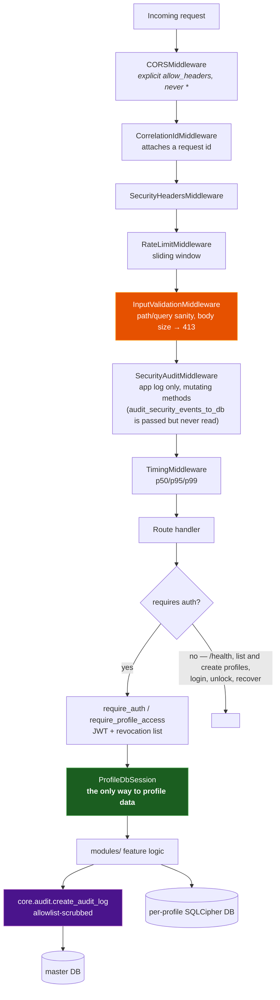
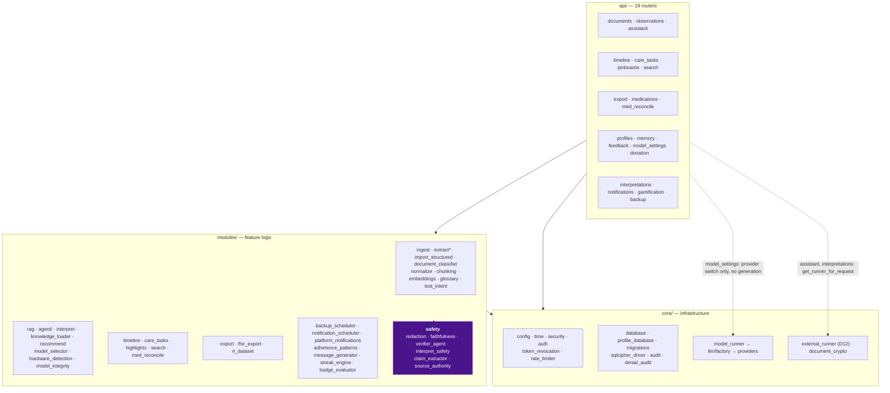
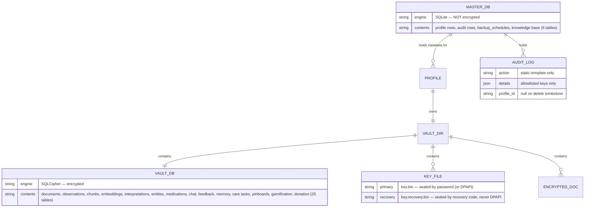
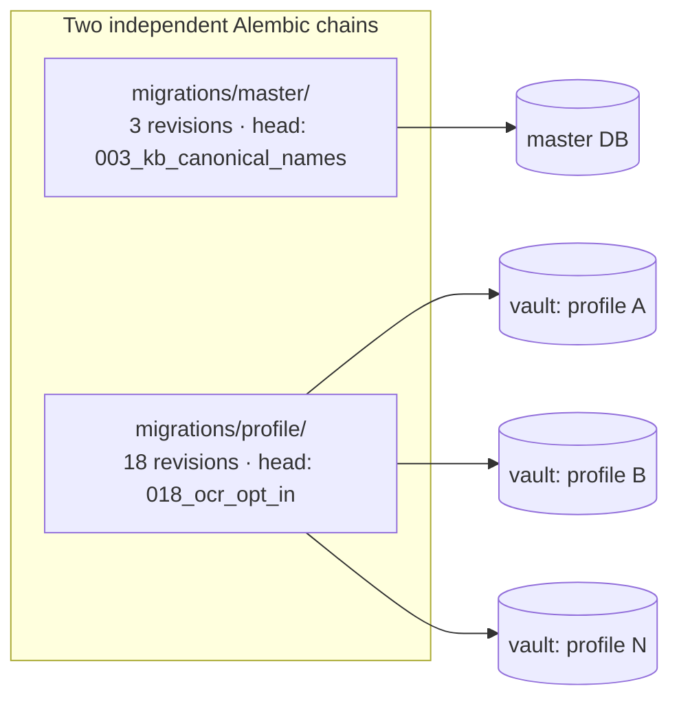

# Backend Structure

**Last Updated:** 2026-11-06 (DOCS-AUDIT-1106: profile head `018_ocr_opt_in`, chain counts, vault table list, `model_selector` reachability)
**Owner:** Project Lead
**Refresh Trigger:** Middleware order changes, a router is added/removed, or a migration chain gains a head

Part of the [architecture diagram set](README.md).

---

## Request lifecycle

Every request crosses the same middleware chain before it reaches a route. The
order is defined in `src/backend/main.py` and matters: cheap rejections happen
before expensive work. Audit **rows** are written by the route handlers (through
`core.audit`), not by middleware: `SecurityAuditMiddleware` writes an app-log line
for each POST, PUT, PATCH and DELETE only.

Two nodes carry invariants rather than just behaviour:

- **`ProfileDbSession`** is the only sanctioned route to patient data. Querying
  profile data through the master `get_db()` breaks per-profile isolation.
- **`create_audit_log`** is a single choke point on purpose. Every `log_*_event`
  helper and every agent audit event passes through it, so the PHI allowlist
  cannot be bypassed by a new call site.

`InputValidationMiddleware` is highlighted because it is the one that returns
before the app runs: oversized bodies get a clean 413 on both the
`Content-Length` path and the streaming path (`_BodyTooLargeError`).

## Module dependency direction

Rules this diagram encodes:

- Dependencies point **downward** by design: `api/` → `modules/` → `core/`,
  and `api/` also imports `core/` directly (auth dependencies, audit helpers,
  sessions).
  Six `core/` modules import from `modules/` today, all inside functions:
  `core/auth.py` (`modules.notification_scheduler`), `core/config.py`
  (`modules.redaction`, `modules.extract`), `core/external_runner.py` (`modules.redaction`),
  `core/model_runner.py` (`modules.model_selector`), `core/document_crypto.py`
  (`modules.ingest`) and `core/llm/llama_cpp_provider.py`
  (`modules.model_integrity`). None imports from `api/`. New `core/` →
  `modules/` imports should not be added.
- Feature code reaches local inference through `ModelRunner` → `llm/factory`.
  Importing `llama_cpp` or calling Ollama directly from feature code is a
  violation. Known deviations: the `llama_cpp` import in
  `ModelSelector.load_model` (`modules/model_selector.py`), reachable only
  through `InterpretModule.interpret_with_model`, which no route calls at this
  revision (owner decision D7: route it through `ModelRunner`, work item W-7,
  not yet implemented) and the opt-in cloud runner
  `core/external_runner.py` (owner decision D12: a documented exception; its
  redaction hardening landed in W-6, and `CLAUDE.md` names it).
  `api/model_settings.py` calls `llm/factory`
  directly only to inspect and switch the provider (and imports
  `ollama_provider._assert_localhost`); it generates no text. That is the first
  dotted edge. The second: `api/assistant.py` and `api/interpretations.py` call
  `core/external_runner.py::get_runner_for_request` and pass its result on as
  the runner, which is how the opt-in cloud path is reached.
- The safety modules are called *by* feature code but are not a layer feature
  code may reshape — they are on CLAUDE.md's ask-first list.

## Startup sequence

The `main.py` lifespan, in order: `core/db_migration.py::migrate_master_db_filename`
(one-time `healthcentral.db` → `asclexis.db` rename), `settings.validate_startup()`,
`core/database.py::init_database` (refuses to start without SQLCipher when
`DATABASE_ENCRYPTION_REQUIRED`; creates `data/`, logs and vault directories),
`run_master_migrations_async()`, the knowledge-base seed
(`scripts/seed_knowledge_base.py::seed_all`, idempotent), then the background
schedulers. `create_app()` installs correlation-id logging and the access-log
query scrub (`core/logging_setup.py`), the middleware chain above, and three
routers: `api_router` under `/api/v1`, the public `/health` router, and the
authenticated metrics router under `/api/v1/monitoring`. Profile vaults are not
opened at startup; each is opened, and migrated, at login or unlock.

## Module inventory: `core/`

| File | What it owns |
|---|---|
| `config.py` | `Settings` (pydantic-settings) and the `settings` singleton; `validate_startup` |
| `database.py` | Master SQLite engine, `Base`, `get_db`, `init_database` |
| `profile_database.py` | `PerProfileDatabaseManager`: per-profile SQLCipher engines, key unseal, `PRAGMA key`, connection cache; `ProfileDatabaseBase` |
| `sqlcipher_driver.py` | `sqlcipher3` import with a stdlib `sqlite3` fallback, `is_sqlcipher_available` |
| `migrations.py` | Both Alembic runners, unversioned-vault matching, the pre-017 snapshot |
| `db_migration.py` | One-time master DB file rename |
| `auth.py` | JWT session dependencies (`require_auth`, `require_profile_access`, `RequireAuth`), `ProfileDbSession`, vault open/close on login/logout, scheduler (un)registration |
| `security.py` | JWT, bcrypt, PBKDF2 (600 000 iterations), recovery codes, DPAPI/password key sealing, Fernet and AES-GCM (`DocumentEncryption`) |
| `token_revocation.py` | Persistent JWT `jti` revocation list |
| `rate_limiter.py` | In-process login and recovery throttles (`auth_rate_limiter`, `recovery_rate_limiter`); not the HTTP `RateLimitMiddleware`, which is `security/rate_limit_middleware.py` |
| `audit.py` | `create_audit_log` (the single choke point), the `log_*_event` helpers, `audit_and_commit`, the PHI allowlists |
| `denial_audit.py` | Capped `denial.cross_profile` audit rows |
| `document_crypto.py` | Decrypting stored documents for read paths |
| `external_runner.py` | Opt-in OpenAI/Anthropic runner, strict redaction, break-glass audit (D12) |
| `model_runner.py` | `ModelRunner`, the facade feature code calls for local inference |
| `llm/` | `factory.get_provider` / `reset_provider`, `LlamaCppProvider` (default), `OllamaProvider` (localhost only), `provider.py` (`ProviderProtocol`, `CapabilityFlags`, `ProviderUnavailableError`) |
| `time.py` | `utcnow` and the other naive-UTC and profile-timezone helpers |
| `logging_setup.py` | Correlation id on log records; query-string scrub on the access log |
| `fk_audit.py` | Report-only orphan-row checks used by `scripts/fk_orphan_audit.py` and migration 017 |
| `feedback_constants.py` | The feedback tag whitelist |

Sibling packages: `security/` (HTTP middleware: headers, rate limit, input
validation, security audit), `monitoring/` (correlation id, timing, health and
metrics routers), `models/` (SQLAlchemy models; master tables on `Base`,
vault tables on `ProfileDatabaseBase`), `scripts/` (backup engine, migrate CLI,
`download_models.py`, knowledge-base seed).

## Data architecture

The profile chain is applied **once per profile database**, so an N-profile
install runs the same migration N times against N separate files. New profile
tables need a new profile migration with a linear `down_revision`; the two
chains never cross.

Where they run: `run_master_migrations_async()` in the `main.py` lifespan
(`core/migrations.py::run_master_migrations`), and
`run_profile_migration_async()` from `PerProfileDatabaseManager.open_profile_database` (`core/profile_database.py`),
which login, unlock, create and recover all reach. A master DB with tables but
no `alembic_version` is stamped to head. A profile vault in that state is
stamped at the **oldest revision its schema matches exactly**
(`_match_unversioned_vault`) and then upgraded to head; a vault that matches no
revision is refused. `tests/test_migration_heads.py` asserts one head and no
merge revisions per chain, and `tests/support/migrations.py::PROFILE_HEAD` is
the head tests compare against. Manual runs: `python -m scripts.migrate
master|profile|status` from `src/backend`.

**Backup schedules live in the master DB too, and for a related reason.** A
background scheduler must know a backup is due while the vault is still
*locked* — and anything inside the vault is unreadable until unlock. So
`backup_schedules` (master migration `002`) holds only ids, enums, counts and
timestamps, and a scheduled run against a locked profile is recorded as
`skipped_locked` rather than claimed as a success.

**Why the master DB is the sensitive one.** It is unencrypted and it is
per-install rather than per-profile, so anything written there escapes both the
encryption boundary and the isolation boundary. That is the entire motivation
for the audit allowlist, and why profile deletion purges audit rows.
