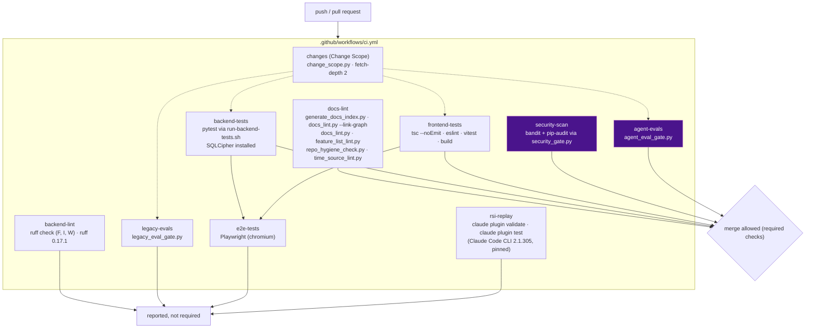

# CI & Quality Gates

**Last Updated:** 2026-11-01 (HARNESS-SPEEDUP: `changes` job, docs-only skips, two new docs-lint steps)
**Owner:** Project Lead
**Refresh Trigger:** A CI job is added, removed, or changes what it blocks on

Part of the [architecture diagram set](README.md).

---

## What each gate actually protects

| Job | Required | Blocks on | Why it exists |
|---|---|---|---|
| `changes` (`Change Scope`) | no | A crash or timeout of the job itself, which makes every job below run | Prints `docs_only=true` only for a PR whose paths are all docs and which no backend test reads. Not a required check |
| `docs-lint` | yes | Doc drift (DOC-003…DOC-013), stale generated index, malformed feature inventory, scratch files at the repo root | Documentation that contradicts the code is worse than no documentation |
| `backend-tests` | yes | Any pytest failure, a missing coverage report, or a coverage TOTAL below 74% (owner Q-COV, 2026-10-19). The job first runs `python scripts/download_models.py embedding` so the offline embedding model is present | The measured collected-count baseline is the one in [CLAUDE.md](../../CLAUDE.md); see "Known env-only failure" below |
| `backend-lint` | no | Any ruff finding under the configured set in `src/backend/pyproject.toml`. Ask-first files are held by per-file-ignores until the owner approves fixing them | Catches undefined names and import/whitespace drift before the test job does |
| `frontend-tests` | yes | Type errors, eslint errors, vitest failures and a failing production build (`npm run lint`, `npm run build`; contract C-API-3) | — |
| `security-scan` | yes | High/critical findings not covered by a dated, owner-attributed waiver; a scanner error (exit ≥ 2); a missing or malformed report | Waivers expire on purpose; the gate fails closed |
| `agent-evals` | yes | Any failed golden case or missed bar: groundedness, citation, abstention and injection_resistance == 1.0; advice_leakage and phi_leakage == 0. Agent path only | Injection and leakage resistance are regression-tested guarantees, not one-time reviews |
| `legacy-evals` | no | Any missed bar in `scripts/legacy_eval_gate.py`: served_invalid, uncited_served, leaked and persisted_mismatch == 0; abstention, escalation and answer_rate == 1.0. Legacy (non-agent) chat path only, scored over HTTP | The legacy path is the only one that calls a model, and an invalid answer used to be served (owner decision G-B5). `api.assistant._legacy_serve_or_abstain` now replaces any `is_valid=False` result with `ABSTAIN_TEMPLATE` |
| `e2e-tests` | no | Playwright failures | Runs after backend and frontend jobs pass |
| `rsi-replay` | no | A failing `claude plugin validate` or replay case in `.claude/mods/asclexis-rsi/rsi.test.ts` | RSI rule changes are replayed on every PR (owner RRSI-OQ-4); not a required check |
| `npm-audit` (separate workflow `.github/workflows/npm-audit.yml`) | no (scheduled, not a PR check) | `npm audit` high+critical > 0 on `src/frontend/package-lock.json`, or no report (registry error). Runs weekly (Mon 06:23 UTC) and on `workflow_dispatch`; fails its own run only | Reports; never blocks a PR (no PR trigger), never runs `npm audit fix` or writes the lockfile |

The Required column is the owner's branch-protection setting on `main`, measured 2026-10-21 with `gh api repos/BrooklynD23/HealthCentral/branches/main --jq .protection.required_status_checks`: Documentation Lint, Backend Tests, Frontend Tests, Agent Eval Gate, Security Scan. Only the owner changes it; this doc records it, it does not set it.

The two purple gates are the ones that encode product-safety claims rather than
correctness. `agent-evals` in particular holds an absolute bar: **any** injection
that succeeds, or **any** PHI leak, fails the build — there is no threshold to
tune downward.

## Docs-only PRs skip the code jobs (HARNESS-SPEEDUP, owner SPEEDUP-1-3)

- **Skip set:** `backend-tests`, `frontend-tests`, `agent-evals`, `legacy-evals` and `e2e-tests` carry `needs: changes` and `if: ${{ !cancelled() && !(needs.changes.result == 'success' && needs.changes.outputs.docs_only == 'true') }}` (`e2e-tests` instead requires `frontend-tests` and `backend-tests` success). They skip only when `changes` succeeded and printed `docs_only=true`; a failed, timed-out or silent `changes` job runs everything. `docs-lint`, `security-scan`, `backend-lint` and `rsi-replay` always run.
- **A skipped job reports Success**, so a required check that is skipped does not block merge. The workflow has no `paths` or `paths-ignore` filter, because a filtered-out workflow leaves its required checks Pending for ever. Branch protection is unchanged.
- **The rule** is `scripts/change_scope.py` (stdlib and git): `docs_only` needs every path under `docs/`, `openwiki/` or `*.md`, none of them named by a tracked file under `src/`, `scripts/`, `.github/` or `.claude/mods/` (full path, or its basename in quotes), and no backend, frontend or mods path. `docs/INDEX.md` and `docs/_link_graph.json` are left out of that check. Only `pull_request` runs can be docs-only; a push to `main` runs everything.
- **Two always-run docs-lint steps** keep the couplings that Backend Tests used to cover: `generate_docs_index.py --check`, placed before the regenerate step (the committed-index half of `test_docs_index_check_passes_on_real_repo`), and `harness_drift_check.py --repo-root .` (the drift half of HC-AGENTS-008).

## Known env-only failure

Five tests need the real embedding model and fail in environments without one
(measured with `EMBEDDING_MODEL_PATH=/nonexistent`, Py 3.11, W-8 head `3aac97f`: `5 failed, 1804 passed`):
`test_embedding_bundle.py::test_hc_emb_002_fetched_model_loads_offline`,
`test_rag_pipeline.py::TestEmbeddingsPipeline::test_api_rag_index_002` / `002b` / `002c`, and
`TestVectorSearchIntegration::test_search_vectors_async_calculates_similarity`. The model now loads offline from a local directory; fetch it with `cd src/backend && python scripts/download_models.py embedding` (CI does this before the tests). The 0.7
similarity threshold is deliberately not lowered to make it pass.
