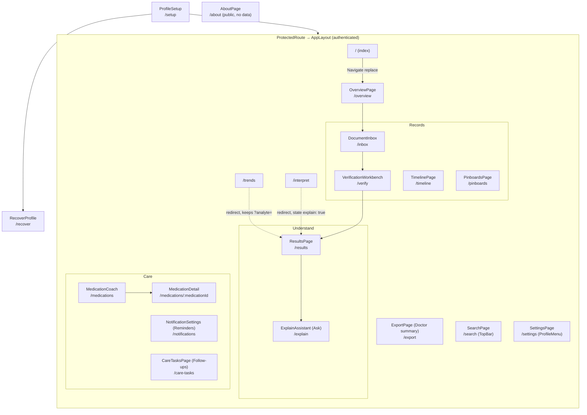
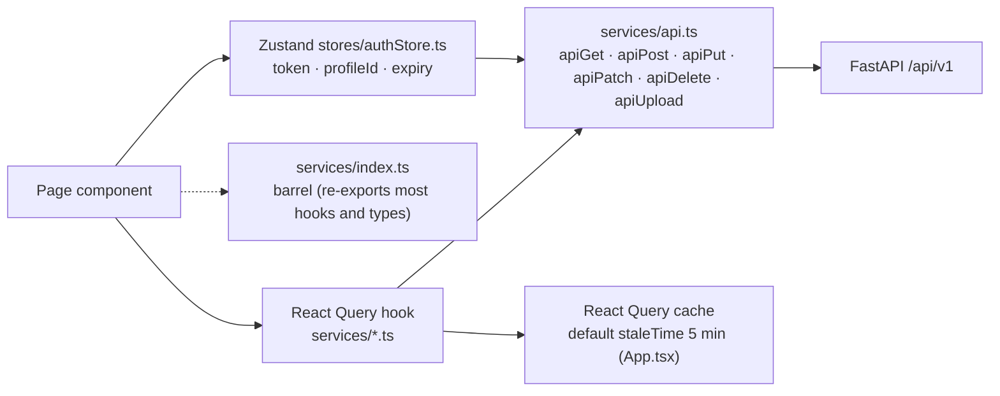
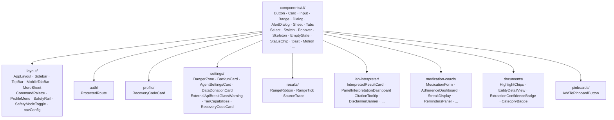

# Frontend Architecture

**Last Updated:** 2026-11-06 (DOCS-AUDIT-1106: routes, shell and tab bar as on `origin/main` after UI-OVERVIEW #507 and UI-PG-RESULTS #476)
**Owner:** Project Lead
**Refresh Trigger:** A page, route, nav entry, service module, or state store is added or removed

Part of the [architecture diagram set](README.md). Paths are relative to
`src/frontend/src/` unless they start with `src/`.

---

## Routes and pages

Every route is declared in `App.tsx`. Everything inside `ProtectedRoute` renders
in `AppLayout`; `/setup`, `/recover` and `/about` render without the shell.

- **`/overview` is the index** (UI-OVERVIEW, #507): `/` redirects there
  (`App.tsx` index route). The page is built from the documents, observations
  and medications queries the other pages already use and adds no endpoint
  (`pages/OverviewPage.tsx` header).
- **`/results` holds Trends and Interpret** (UI-PG-RESULTS, #476). `/trends`
  and `/interpret` are kept only as redirects (`RedirectToResults` in
  `App.tsx`); `/interpret` opens the Explain panel through router state. The
  Range Ribbon (`components/results/RangeRibbon.tsx`) replaces Recharts on this
  page, and the lab-interpreter components are imported by path so Recharts
  stays out of the Results bundle (UI-BUDGET).
- Unknown paths redirect to `/` (`App.tsx` `path="*"`).
- 17 page components live in `pages/` (`ls src/frontend/src/pages/*.tsx`), plus
  `pages/settings/` (the four Settings sections: Advanced, Assistant privacy,
  Preferences, Security).

## Shell and navigation

```mermaid
flowchart LR
    NAV["components/layout/navConfig.ts<br/><i>every destination name</i>"] --> SIDEBAR["Sidebar<br/>lg and up: navGroups"]
    NAV --> TABS["MobileTabBar<br/>below lg: navTabs"]
    NAV --> MORE["MoreSheet<br/>every group"]
    TABS -->|"More"| MORE
    LAYOUT["AppLayout"] --> SIDEBAR
    LAYOUT --> TOP["TopBar<br/>search link · SafetyModeToggle<br/>ProfileMenu (Settings, About)"]
    LAYOUT --> RAIL["SafetyRail"]
    LAYOUT --> TABS
    LAYOUT --> PAL["CommandPalette (lazy)"]
```

`navConfig.ts` is the single place destination names live (UI-SHELL):

| Group (`navGroups`) | Entries (label → path) |
|---|---|
| (unlabelled, first) | Overview → `/overview` |
| Records | Documents → `/inbox` · Review values → `/verify` · Timeline → `/timeline` · Pinboards → `/pinboards` |
| Understand | Results → `/results` · Ask → `/explain` |
| Care | Medications → `/medications` · Reminders → `/notifications` · Follow-ups → `/care-tasks` |
| Share | Doctor summary → `/export` |

The phone tab bar (`navTabs`) has five slots: **Overview, Results, Documents,
Ask, More**. More opens `MoreSheet` with every group. Search and Settings are
not nav entries: Search is linked from `TopBar`, Settings and About from
`ProfileMenu`.

## Data flow

Conventions, stated as they are today:

- **Service modules** (`services/`): one file per backend area (`assistant`,
  `backup`, `careTasks`, `documentCategories`, `documents`, `donation`,
  `export`, `feedback`, `gamification`, `highlights`, `interpretations`,
  `medReconcile`, `medications`, `memory`, `modelSettings`, `notifications`,
  `observations`, `pinboards`, `profiles`, `search`, `timeline`), plus `api.ts`
  (fetch wrapper) and `types.ts`. `services/index.ts` is a barrel that
  re-exports every module except `backup`, `donation`, `interpretations` and
  `medications`, but it is not the only import surface: on 2026-11-06, 39 files under `pages/`,
  `components/` and `hooks/` imported a service module by path and 15 imported
  the barrel (`grep -rlE "from '(@/services|\.\./services)/[a-zA-Z]+'"`).
- **Server state lives in React Query; only session state lives in Zustand.**
  The auth store holds the token, profile id and expiry. Some hooks override
  the 5-minute default (`services/assistant.ts`).
- **Hooks** (`hooks/`): `useReducedMotion`, `useSafetyMode`. Motion tokens and
  the provider are in `motion/`; theme in `theme/`.

## Component families

Top-level components outside a family: `ErrorBoundary`, `MedicationOverlay`,
`MemoryManager`, `PageImageOverlay`, `TrendVerificationMarkers`.

## Tests and scripts

- Unit and component tests: vitest, `src/frontend/src/__tests__/`.
- End-to-end: Playwright, `src/frontend/e2e/*.spec.ts` (the `ui-*` specs cover
  the UI program pages; G3 specs also run on a production build in CI job
  `g3-preview`, see [CI & quality gates](ci-and-quality-gates.md)).
- `package.json` scripts: `dev`, `build` (`tsc && vite build`), `build:check`
  (build plus `scripts/check-bundle.mjs` bundle budget), `preview`, `lint`,
  `test`, `test:run`, `e2e`, `e2e:ui`.

Accessibility is a requirement rather than a polish pass: WCAG 2.2 AA, 44 px
targets, keyboard navigation, screen-reader labels, 200 % zoom, and reduced
motion honoured through `useReducedMotion`.
