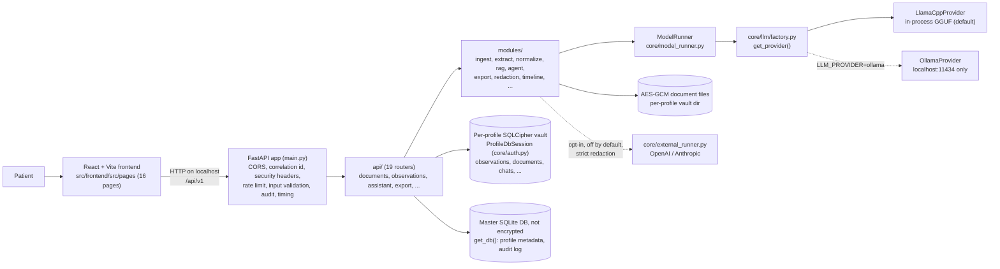
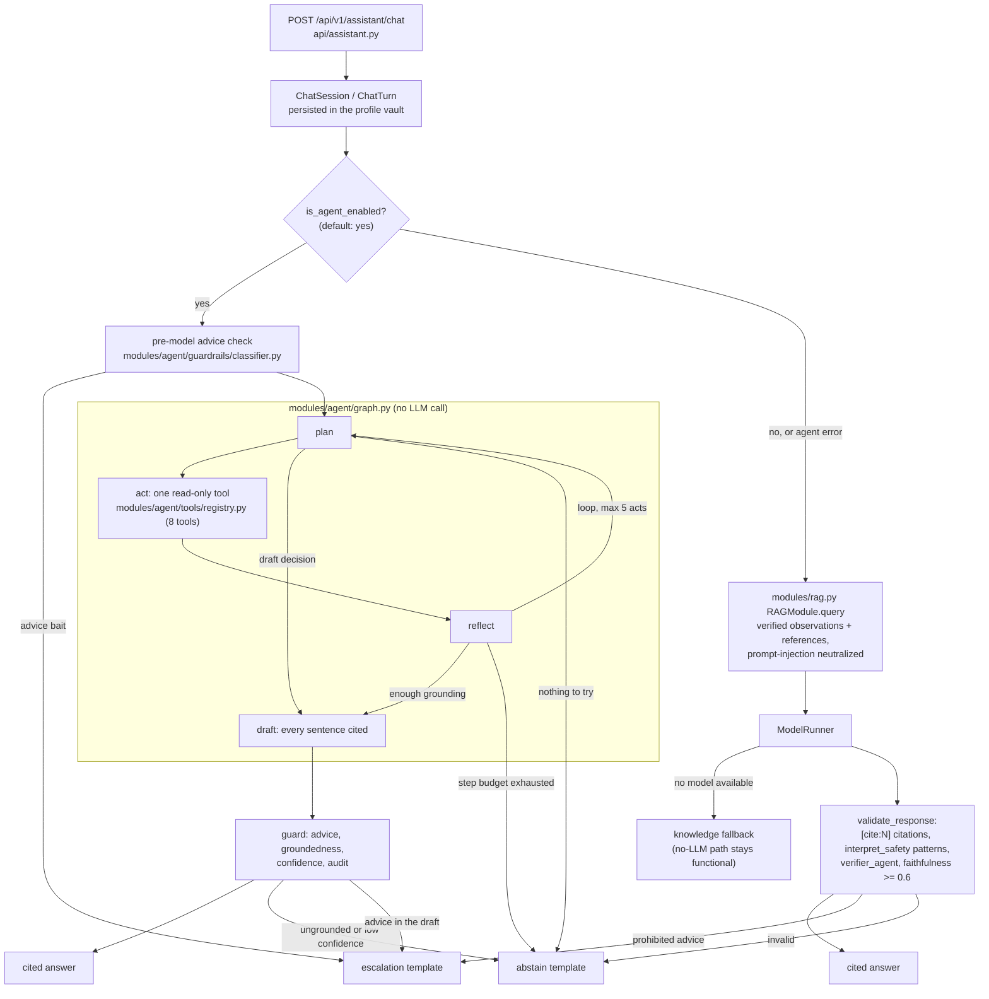
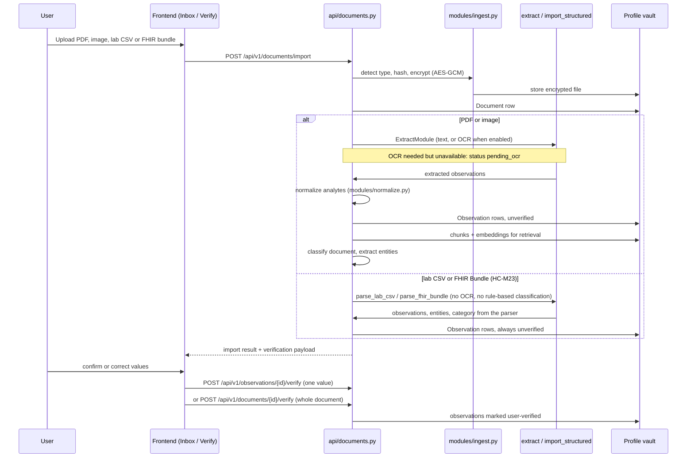
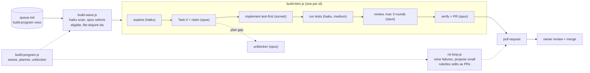

# System Overview

**Last Updated:** 2026-10-25
**Owner:** Project Lead
**Refresh Trigger:** A principle, top-level component, privacy boundary, or stack choice changes

Moved verbatim from the repository [README](../../README.md) on 2026-10-25 so the README can stay a short entry point. Part of the [architecture diagram set](README.md).

## Overview

Asclexis helps patients:
- **Import** lab PDFs, images, and CSV/FHIR R4 exports from other systems into an encrypted local vault
- **Extract & Verify** structured data with human-in-the-loop verification. Everything extracted lands unverified until the user confirms it; structured (CSV/FHIR) imports are no exception, and medication mentions become reconciliation suggestions, never direct changes to the medication list
- **Visualize** longitudinal trends with reference-range context; unverified points are labelled as such
- **Understand** results through a read-only assistant that answers with citations, including bounded questions about open care tasks, medication changes, and the record timeline
- **Export** doctor-ready summaries, discussion prompts, and a verified-only, redacted FHIR R4 bundle

## Core Principles

- **Local-first.** The app, its databases, and model inference run on the user's machine. The Ollama provider is pinned to localhost. The only outbound paths are user-initiated: model downloads, and an opt-in external LLM runner that is off by default and strictly redacted (see [Privacy boundaries](#privacy-boundaries)).
- **Encrypted at rest.** Each profile has its own SQLCipher vault and AES-GCM document store. Encryption is required by default (`DATABASE_ENCRYPTION_REQUIRED`); a dev setup without SQLCipher runs unencrypted and must not hold real data.
- **Grounded outputs.** Assistant answers cite the user's records or curated references, or abstain.
- **Conservative behavior.** "Insufficient information" is preferred over speculation; abstain and escalate are first-class outcomes.
- **No medical advice.** Education only: no diagnosis, dosing, or treatment recommendations. Prohibited-advice patterns are checked before an answer is shown.
- **Compliance posture.** The project is designed as if HIPAA applied (owner choice, 2026-09-27). That is a design posture, not a compliance claim or certification. See [`docs/compliance/`](../compliance/README.md).

## Architecture

Four diagrams below give the shape of the system. The full hand-maintained set
(request lifecycle and middleware chain, module dependency direction, the
dual-database and dual-migration data architecture, frontend structure, the
safety and privacy control-flow, and CI gates) lives in
**[`docs/architecture/`](README.md)**, alongside a
[performance & scalability review](performance-scalability-review.md).
Paths below are relative to `src/backend/` unless they start with `src/`.

### System overview



All feature-code inference goes through `ModelRunner`. The single named
exception is the opt-in external runner (owner decision D12), which applies
`strict` redaction on every call; break-glass is the only bypass and writes an
audit record. Patient data is only read through `ProfileDbSession`; the master
DB holds profile metadata and the audit log.

### Assistant chat: agent path and legacy RAG path



The agent path is the default (`modules/agent/settings.py`); a per-profile flag
switches back to single-shot RAG. On the legacy path, `[cite:N]` is the
validated citation marker; `[YOUR_RESULTS:N]` and `[REFERENCE:N]` are context
labels only. Details: [`docs/architecture/pipelines.md`](pipelines.md).

### Document to observations



Undated observations are listed but excluded from time series; `POST
/documents/{id}/reprocess` re-extracts (except for CSV/FHIR imports, which
have no text to rebuild from).

### Build-program agent workflow (contributors)

Most recent work in this repository is planned and built by Claude Code agents
following [`docs/plans/2026-10-15-build-program/RUNBOOK.md`](../plans/2026-10-15-build-program/RUNBOOK.md),
sequenced by the workflow scripts in `.claude/workflows/`. A human owner
records decisions and merges.



Per-phase model routing is in the workflow scripts' `meta` blocks and
[`docs/agentic/orchestration.md`](../agentic/orchestration.md); behavioral
rules and the definition of done are in [`CLAUDE.md`](../../CLAUDE.md) and
[`AGENT.md`](../../AGENT.md).

### Privacy boundaries

- **Exports that leave the app pass through `modules/redaction.py` first:** the
  doctor summary (strict), FHIR R4 bundle, visit-prep packets, and the RL
  feedback dataset. `GET /export/csv` and `GET /export/json` are the patient's
  own full-fidelity export and are deliberately not redacted (owner decision D3).
- **Backups are unredacted by design** (a redacted backup cannot be restored)
  and are profile-scoped.
- **Audit logging** covers routes that touch documents, observations, or profile
  data. The audit log lives in the unencrypted master DB, so its rows are
  minimized (AUDIT-PHI-001).

## Technology Stack

- **Backend**: Python 3.11+, FastAPI, SQLAlchemy, Alembic (separate master and profile chains)
- **Databases**: SQLite master DB plus per-profile SQLCipher vault DBs
- **Document vault**: AES-GCM encrypted files under per-profile vault directories
- **Retrieval**: per-profile embedding blobs scanned with a linear cosine-similarity pass (no external vector index at single-user scale), plus curated reference content seeded at startup
- **Local LLM**: llama-cpp-python with GGUF models (default), or Ollama on localhost
- **Embeddings**: `sentence-transformers/all-MiniLM-L6-v2`, fetched once and loaded offline (`modules/embeddings.py`)
- **Optional external LLMs**: OpenAI/Anthropic runner, opt-in, strict redaction (`core/external_runner.py`)
- **Frontend**: React + Vite + TypeScript, Tailwind, React Router, TanStack Query, Zustand

### Scalability posture

The meaningful scaling axis here is **one person's record growing over years**,
not concurrent users; this is a local-first desktop application by design.
Known limits (search rebuilds its FTS index per query, a few generated-export
stores are in memory without a TTL, LLM inference is in-process and blocking)
and what this system deliberately does *not* need are written up in
[`docs/architecture/performance-scalability-review.md`](performance-scalability-review.md).

## Project Structure

```
HealthCentral/
├── AGENT.md, CLAUDE.md        # contributor and agent briefing, behavioral rules
├── dev.ps1, dev.bat, dev.sh   # one-command dev launchers (Windows, WSL/Linux)
├── config/                    # .env.example
├── docs/                      # architecture, API, user, compliance, plans, reviews, archive
├── scripts/                   # docs lint/index, hygiene, eval and security gates
├── skills/                    # project domain skills (agent, guardrails, backend, evals)
├── .claude/                   # vendored process skills, agents, build-program workflows
└── src/
    ├── backend/
    │   ├── main.py            # app factory, middleware, router mount
    │   ├── api/               # FastAPI routers
    │   ├── core/              # config, auth, db, audit, time, ModelRunner, llm/ providers
    │   ├── models/            # SQLAlchemy models
    │   ├── modules/           # feature logic (ingest, extract, rag, agent/, redaction, ...)
    │   ├── migrations/        # master/ and profile/ Alembic chains
    │   ├── monitoring/        # metrics, correlation ids, timing
    │   ├── security/          # input validation, rate limiting, headers
    │   ├── scripts/           # backup, migrate, download_models, seed knowledge
    │   └── tests/             # pytest suites (incl. agent/ golden evals)
    └── frontend/
        ├── src/               # pages/, components/, services/, stores/
        └── e2e/               # Playwright specs
```

`data/` and `models/` are created locally and gitignored.

## Documentation map

Moved verbatim from the README "Documentation" section on 2026-10-25.

- **Users:** [Getting Started](../user/getting-started.md) · [Workflows](../user/workflows.md) · [Troubleshooting](../user/troubleshooting.md) · [FAQ](../user/faq.md)
- **Developers:** [API docs](../api/README.md) · [Live endpoints](../api/endpoints.md) · [Architecture diagrams](README.md) · [Roles index](../roles/00_roles_index.md) · [Documentation index](../00_architecture_plans_index.md) · [Recurring failure modes](../agentic/recurring-failures.md)
- **Compliance & operations:** [HIPAA controls](../compliance/hipaa-controls.md) · [Data privacy](../compliance/data-privacy.md) · [Disaster recovery](../compliance/disaster-recovery.md) · [Audit checklist](../compliance/audit-checklist.md)
- **Agent overhaul (shipped):** the read-only plan→act→reflect agent under `src/backend/modules/agent/` replaced single-shot RAG as the default chat path. PRD: [PRD_agent_overhaul.md](../prd/PRD_agent_overhaul.md); process: [AGILE_PLAN](../agile/AGILE_PLAN.md) · [RELEASE_CHECKLIST](../agile/RELEASE_CHECKLIST.md); completed phase and sprint records are under [`docs/archive/`](../archive/README.md). Its 74 golden eval cases live in `src/backend/tests/agent/golden/`, gated by `scripts/agent_eval_gate.py`. Domain skills: [asclexis-agent](../../skills/asclexis-agent/SKILL.md) · [asclexis-guardrails](../../skills/asclexis-guardrails/SKILL.md) · [asclexis-backend](../../skills/asclexis-backend/SKILL.md) · [asclexis-evals](../../skills/asclexis-evals/SKILL.md).
