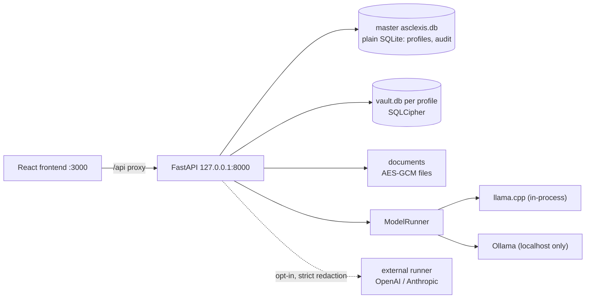

# Asclexis — Senior Project Report, Phase 1 Draft

**Last Updated:** 2026-11-11
**Owner:** repository owner
**Status:** DRAFT (Phase 1). Measured on `origin/main` @ `e5c7bf80` (2026-11-11, the merge of #598) unless a row says otherwise. Material from the owner's other projects will be added in Phase 2 wherever `[PHASE 2 PLACEHOLDER]` appears.
**Refresh Trigger:** any change to a number in this file; a new owner decision cited here; the Phase 2 merge of other-project material.

Companion files: [presentation-outline.md](presentation-outline.md) (slides) and [evidence-index.md](evidence-index.md) (claim → source table, evidence gaps, lineage). Load-bearing claims reuse the rows of the existing [claims ledger](../claims-ledger.md) (cited as "ledger C1", "ledger H12" and so on); this draft does not start a second ledger.

**Rules this draft follows.** Every claim names a file path, PR number or commit. Where the repo holds no evidence, the text says `[evidence gap]`. Status words are strict: *merged* means on `origin/main`; *planned* means a plan exists and no code does; *case study* means an observation with no denominator, no comparison and no cost data, reported as an example and never as a rate (ledger verdict `CASE-STUDY`). Paths under `api/`, `core/`, `modules/`, `models/`, `migrations/` and `tests/` are relative to `src/backend/`. All data mentioned is synthetic; no patient data was used. Dates are the author's local time (US Pacific); GitHub shows some late-evening merges on the next UTC day.

**This draft builds on earlier reports.** It carries forward and supersedes the May 2026 CS4610 Final Report and Technical Companion (`CS4610_Report_Demo/`), the capstone knowledge base in `docs/capstone-report/`, the 2026-09-25 repository audit (`audit/2026-09-25/Devin-Audit-report.md`), and the research and plan documents listed in the [evidence index, Lineage](evidence-index.md#lineage). Where a prior report was wrong, the correction is stated where the topic comes up and again in [Appendix A](#appendix-a--status-of-the-may-2026-report-claims).

**ID legend.** The repo names work and decisions with short IDs, used throughout:

| ID | Meaning | Where defined |
|---|---|---|
| C*n*, H*n*, M*n* | rows of the claims ledger (product, harness, methodology) | `docs/capstone-report/claims-ledger.md` |
| D1–D13 | owner decisions of 2026-09-27; later rows have names (e.g. AUTO-MERGE) | `owner-decisions-2026-09-27.md` |
| P1–P8, W-1…W-11b, S-1 | phases and work items of the implementation program that followed the September audit | `implementation-program.md`; `docs/plans/2026-09-27-*.md` |
| L0, L1, L2 | orchestrator tiers: program orchestrator, wave orchestrator, implementer or reviewer | `docs/agentic/orchestration.md` §1 |
| Task 0 | the checks a build item must pass before any code | `RUNBOOK.md` §4 |
| G1–G10 | UI quality gates in the e2e suite (G3 runs on a production build; G10 is "stillness") | `src/frontend/e2e/support/gates.ts` |
| count slot | the collected-test number in `CLAUDE.md` and `AGENT.md` | `contracts.md` §d |
| queue row | one build-program item, e.g. UIDOC-006A-FLAKE | `docs/plans/2026-10-15-build-program/queue.md` |

---

## Contents

- [Executive summary](#executive-summary)
- Part I — The application
  - [1. The application end to end](#1-the-application-end-to-end)
  - [2. Model-agnostic design](#2-model-agnostic-design)
  - [3. Product evaluation](#3-product-evaluation)
- Part II — Building it with agents
  - [4. Building with agents: Claude Code, Codex, Cursor, Devin](#4-building-with-agents-claude-code-codex-cursor-devin)
  - [5. Verification discipline](#5-verification-discipline)
  - [6. Model orchestration and routing](#6-model-orchestration-and-routing)
  - [7. Context management, MCP, skills and token efficiency](#7-context-management-mcp-skills-and-token-efficiency)
  - [8. The RSI loops](#8-the-rsi-loops)
- Part III — Assessment
  - [9. Related work](#9-related-work)
  - [10. Limitations, ethics and threats to validity](#10-limitations-ethics-and-threats-to-validity)
  - [11. Future work](#11-future-work)
  - [12. Conclusion](#12-conclusion)
  - [13. References](#13-references)
- [Appendix A — Status of the May 2026 report claims](#appendix-a--status-of-the-may-2026-report-claims)
- [Appendix B — Reproducing the numbers](#appendix-b--reproducing-the-numbers)

---

## Executive summary

**The product.** Asclexis (formerly HealthCentral) is a local-first health-records companion. A patient imports lab PDFs, images or FHIR files into an encrypted vault that belongs to one profile, checks the values the app extracted, sees trends over time, and asks an assistant questions that must be answered from the patient's own records with citations. It runs as a local web app: a FastAPI backend bound to `127.0.0.1` and a React frontend, started by `dev.ps1` or `dev.sh` (`docs/capstone-report/architecture-overview.md` §1; ledger C8, C30). Its outputs are educational, never medical advice (`CLAUDE.md`, Hard invariants).

**The research question.** The project is also a study of how a developer's role changes when most code is written by coding agents: the work moves from writing code to designing the environment the agents work in, which the project calls the harness (`docs/capstone-report/00-original-goal.md`, Research goal). The thesis carried from the earlier outline is: **the harness is the deliverable, and its failures are the findings** (`docs/capstone-report/report-outline.md` §10).

**Headline numbers (measured 2026-11-11 unless noted).**

| Measure | Value | Source |
|---|---|---|
| Backend tests collected | 4984 on `e5c7bf80` (Python 3.11 venv, WSL) | `pytest --collect-only`, run for this draft ([Appendix B](#appendix-b--reproducing-the-numbers)) |
| Backend tests, earlier | 621 on 2026-06-11 (Python 3.10); 1245 collected at `fd8984e7` (2026-08-03, first value of the `collected` slot); 1245 again on `40f590e` on 2026-09-27 with Windows Python 3.13 | `docs/plans/implementation-log/2026-06-11_verification-report.md` §2; `git log -G` on `CLAUDE.md`; audit addendum A-2; ledger M8 |
| Merged pull requests | 593 (Feb 2026 – Nov 2026): 393 merged in October, 179 in November | `gh pr list --state merged` (Appendix B) |
| Commits reachable from `main` | 3836 (first commit 2025-12-28) | `git log` (Appendix B) |
| Commits with a Claude co-author trailer, Oct 2026 | 1567 of 2371 | `git log --grep` (Appendix B) |
| Recurring failure modes documented | 21 | headings of `docs/agentic/recurring-failures.md` |
| Skills shipped in the repo | 36: 32 process skills, 4 domain skills | `find .claude/skills skills -name SKILL.md` |
| CI jobs on every PR | 11 in `.github/workflows/ci.yml` | `ci.yml` job list |
| Agent safety eval | 74 golden cases, six axes, absolute bars | `docs/agentic/evals.md:22`; `tests/agent/golden/` |

The two test counts are not like for like: they come from different machines, interpreters and SQLCipher availability. They show growth in what is checked, not product quality (§5.5).

**What this report corrects.** The May 2026 report described an AES-256 SQLCipher store for "every byte", a backup that "leaks nothing", "no cloud", a desktop application, and a hook ("AgentShield") that blocked PHI from leaving the machine. A repository re-check found each of these false or not evidenced. The master database is plain SQLite, each backup carries a reduced master copy, an opt-in cloud path exists, there is no installer, and no such hook exists (`CS4610_Report_Demo/README.md`; ledger C8, C10, C16, C17, C18, H5, H6). This report states the current facts where each topic comes up and lists every May claim with its status in Appendix A.

**What the method produced.** From late September 2026 the work ran as an orchestrated program. An Opus orchestrator (L0) planned, reviewed and merged; Sonnet implementers built one queue row per worktree and pull request; Haiku agents explored and ran tests; Codex reviewed architectural plans and diffs; Devin was wired in as a third runtime (`docs/agentic/orchestration.md` §1; `docs/plans/2026-10-15-build-program/RUNBOOK.md` §1). The rules that program follows (Task 0 checks, count slots, the quiet box, docs batches before code merges) each exist because a specific failure happened first (§5, §6). The verification record is the strongest evidence in the repo, and also the most humbling: a green backend suite once coexisted with a restore endpoint that returned 400 on every request and a backup download that shipped other profiles' password hashes (`docs/agentic/recurring-failures.md` §1).

**What is not shown.** There is no measured comparison between single-agent and multi-agent work, no dollar-cost accounting, and no user study. The self-improvement (RSI) loop has merged two rule changes and has shown no causal improvement (§8). These are listed as evidence gaps, not filled with estimates.

[PHASE 2 PLACEHOLDER: one paragraph placing Asclexis among the owner's other projects, and which findings recur across them.]

---

# Part I — The application

## 1. The application end to end

### 1.1 Problem and goal

The motivation is unchanged from the May report: the author's mother receives autoimmune bloodwork every few months with little explanation, and cloud tools trade privacy for convenience (`docs/capstone-report/00-original-goal.md`; CS4610 Final Report §2). The product requirements are in `docs/Local_First_Medical_Results_Companion_PRD_v0_1.md`. The non-negotiables the project set itself are: patient data stays on the device, a human verifies extracted values before they are trusted, every assistant claim is cited, and deleting a profile is a cryptographic erase (`00-original-goal.md`, Product goal).

### 1.2 Local-first architecture

| Layer | Current fact | Evidence |
|---|---|---|
| Processes | `dev.ps1` / `dev.sh` start the backend on 8000 and the frontend on 3000; the backend binds `127.0.0.1` in local mode; CORS allows only `localhost:3000` and `127.0.0.1:3000` | `src/backend/main.py:121-123,180-191`; `architecture-overview.md` §1 |
| Backend | FastAPI app factory `create_app()`; 19 routers mounted under `/api/v1` (profiles, documents, observations, interpretations, medications, notifications, assistant, export, model settings, memory, gamification, care tasks, timeline, medication reconciliation, pinboards, search, backup, feedback, donation); 45 Python files plus the `agent/` package in `modules/` | `main.py:104,167`; `api/__init__.py:48-72`; `git ls-files 'src/backend/modules/*.py'` |
| Frontend | React 18.3.1, Vite 7, TypeScript 5, Tailwind 4, TanStack Query 5, Zustand, React Router 7; Vitest 4 and Playwright 1.58 with axe-core; 17 pages, routes in `App.tsx:233-267` | `src/frontend/package.json`; `src/frontend/src/App.tsx` |
| Master database | plain SQLite `data/asclexis.db`, **not encrypted**: profiles (display names, password hashes), audit rows, backup schedules, the knowledge base | `core/config.py:41`; `core/database.py:62-71`; ledger C18 |
| Per-profile vault | `data/vaults/<id>/vault.db`, opened through `sqlcipher3` with `PRAGMA key` on connect; profile migrations run on every open | `core/profile_database.py:136-139,264-393` |
| Keys | the data key is a Fernet key; the password KDF is PBKDF2-HMAC-SHA256 at 600,000 iterations; the key is sealed by DPAPI on Windows or by the password, with a recovery-code-sealed copy beside the vault | `core/security.py:184-198,314-384`; `core/profile_database.py:141-163` |
| Document files | AES-GCM with the profile key and a fresh IV per file (not per-document keys, as the May report said) | `core/security.py:443`; `modules/ingest.py:175`; ledger C21 |
| Isolation | the profile id comes from the JWT `sub`, never a request parameter; profile data is read only through the `ProfileDbSession` dependency, which returns 401 when the vault is not open; `require_profile_access` returns 403 for another profile's path | `core/auth.py:191,286,300-341`; `CLAUDE.md` Hard invariants |
| Foreign keys | `PRAGMA foreign_keys` is now installed on the master and profile engines, closing the 2026-09-27 finding that declared `ondelete` actions were inert | `core/database.py:46-71`; `core/profile_database.py:380-382`; profile migration `017_fk_cascade_alignment` |




**Dual migration chains.** The master and profile databases have separate Alembic chains (`CLAUDE.md` Hard invariants). The master chain has 3 revisions (`001_initial_schema`, `002_backup_schedules`, `003_kb_canonical_names`). The profile chain has grown from 12 revisions on 2026-09-27 to 19 today, head `019_export_artifacts` (`ls src/backend/migrations/*/versions/`). `tests/test_migration_heads.py` (HC-MIGHEAD-001…003) pins one head per chain, and an unversioned vault is matched to its oldest tied revision and upgraded rather than stamped to head (`architecture-overview.md` §10, 2026-11-06 note; #512).

**Encryption caveats that stay open.** The backend suite runs with `DATABASE_ENCRYPTION_REQUIRED=false`, so no backend test checks on-disk ciphertext; only the e2e run exercises it (ledger C1). On Windows, where SQLCipher may not install, the dev launcher can fall back to unencrypted vaults (ledger C16). The master database remains unencrypted and holds names and password hashes (ledger C18).

### 1.3 Documents, extraction, observations and trends

The document path (`api/documents.py`):

1. `POST /api/v1/documents/import` (`:410-415`) → `IngestModule.import_document` validates (50 MB cap), hashes, and encrypts and stores the file (`modules/ingest.py:93-247`).
2. `_run_extraction_pipeline` (`:583`) routes text PDFs to `pdfplumber`, scanned PDFs and images to a bundled, hash-pinned RapidOCR engine when the user has opted in to OCR (`modules/extract.py:100-198`; profile migration `018_ocr_opt_in`), and CSV or FHIR files to the structured importer (`:738`; `modules/import_structured.py:149,358`).
3. Observations are created with `user_verified=False` (`:681,794`). Chunks and embeddings are created at import, before verification (`:864`).
4. Classifiers and extractors for imaging, pathology and visit notes run next; the visit-note extractor may ask the LLM for help through `ModelRunner` (`:965`; `modules/extract_visit_notes.py:477-493`).
5. The user verifies values in the Verification Workbench (`POST /observations/{id}/verify`, `api/observations.py:458`; undo at `:657`).

Analyte names and units are normalised in ordinary code (`modules/normalize.py`, `modules/glossary.py`), not in a skill as the May report said (ledger H16).

**What reads unverified data.** Agent tools, FHIR export, visit prep and pinboards read verified data only (`architecture-overview.md` §5). The trends endpoint returns every point and marks each with `user_verified` (`api/observations.py:712-819`), which is what owner decision D4 (2026-09-27) asked for: unverified points may appear if they are visibly marked (`owner-decisions-2026-09-27.md:16`; plan W-3).

**Extraction quality** is measured on a synthetic golden set. On 2026-10-18 analyte, unit and date extraction scored 28 true positives, 0 false positives and 0 false negatives; the day before it was 26/0/2 (`docs/agentic/eval-cards/extraction.md`; test `HC-EXTR-003`).

### 1.4 The assistant, RAG and citations

`POST /assistant/chat` (`api/assistant.py:1123`) has two paths (`architecture-overview.md` §6):

1. **Agent path, on by default** (`AGENT_ENABLED_DEFAULT = True`, `modules/agent/settings.py:19`). Plan → act (at most 5 steps) → reflect → draft → guard, over 8 read-only tools that read verified data only. **The draft is deterministic template composition; nothing under `modules/agent/` calls a model** (`grep`; ledger C14). The hard-coded `faithfulness_score=1.0` that the 2026-09-27 re-check found on `main` had already been fixed on a research branch (`cc202d98`, 2026-09-10); it reached `main` through PR #21 on 2026-09-29 (phase P1; `report-outline.md` §3).
2. **Legacy RAG path**, used when the agent is switched off or fails. `RAGModule.query` (`modules/rag.py:1278`) retrieves the top 10 chunks by cosine similarity over embeddings stored in the vault itself (no separate vector database; `rag.py:582-699`; `models/embedding.py:34`), calls the LLM through `ModelRunner`, and validates the answer in `RAGModule.validate_response` (`rag.py:888-985`). That check rejects unknown `[cite:N]` ids, requires a citation on every report-facts segment, applies the `interpret_safety` prohibited patterns, runs claim verification, and requires a faithfulness score of at least 0.6 (`rag.py:917-966`). `[cite:N]` is the validated marker; `[YOUR_RESULTS:N]` and `[REFERENCE:N]` are context labels, not markers (owner decision D11). Since W-4 the legacy path abstains when validation fails instead of serving the answer (ledger C28).

The embedding model is the fetched, gitignored `all-MiniLM-L6-v2` bundle, hash-pinned and loaded with `local_files_only=True`; without it, retrieval fails closed (`modules/embeddings.py:16-185`; `rag.py:669-674`; W-8, ledger C12). Without the bundle exactly five named tests fail, and `CLAUDE.md` §4 forbids "fixing" them by lowering the 0.7 threshold, which is the embedding-similarity assertion in `tests/test_rag_pipeline.py:269`. The production retrieval itself has no similarity cutoff; it returns the top 10 (`rag.py:696-699`). The verifier's entailment threshold is a separate 0.7 (`modules/verifier_agent.py:76`).

**Correction to the May report.** The May report described the assistant as "a locally hosted LLM grounded in RAG" (Final Report §1, §3.2). The default assistant makes no LLM call; the LLM path is the fallback (`CS4610_Report_Demo/README.md`, Changed since submission; ledger C14). A strict safety mode (profile migration `016_strict_safety_mode`; `GET /assistant/safety-mode`, `api/assistant.py:717`) was added later.

### 1.5 Safety layers, redaction and audit logging

| Layer | What it does | Evidence |
|---|---|---|
| `modules/interpret_safety.py` | `PROHIBITED_PATTERNS` (diagnostic language, certainty claims, dosing, medication advice, start/stop instructions), required disclaimers, critical-value checks; reused by the legacy RAG validator | `interpret_safety.py:34-95`; `rag.py:933-938` |
| `modules/verifier_agent.py` | rule-based entailment per claim (the LLM entailment option is off by default); at least one supporting source; fails on contradiction | `verifier_agent.py:72-89,141,537` |
| `modules/faithfulness.py` | faithfulness score per response, minimum 0.6 | `faithfulness.py:46-55`; `rag.py:961-966` |
| Agent guard | maps every sentence to a source; applies the advice classifier and templates | `modules/agent/guardrails/guard.py` |
| `modules/redaction.py` | rule engine with three policy levels: `strict` (adds DOB, address, MRN, labelled IDs, dates, name guard), `standard` (email, phone, names in context), `minimal` (SSN) | `redaction.py:23-286` |
| Audit | one choke point, `create_audit_log`, scrubs action text against an allow-list and writes an `audit_logs` row to the master DB; wrappers per domain (`log_profile_event`, `log_document_event`, `log_observation_event`, `log_export_event`, `log_auth_event` and others) | `core/audit.py:36,202-513` |
| Agent safety eval | 74 golden cases; groundedness, citation coverage, abstention and injection resistance must equal 1.0; advice leakage and PHI leakage must equal 0; CI fails on any regression | `docs/agentic/evals.md:22`; `scripts/agent_eval_gate.py` |

The four modules `interpret_safety`, `redaction`, `faithfulness` and `verifier_agent`, plus auth and encryption code, are ask-first: agents must ask the owner before editing them, and the self-improvement loop's write scope excludes them (`CLAUDE.md` §1; §8 below).

**Redaction before anything leaves.** Owner decision D3 (2026-09-27) exempts only `GET /export/csv` and `GET /export/json`, the patient's own full-fidelity export. The doctor summary goes to a third party and is now strict-redacted before it is stored (`api/export.py:673-675`; `modules/export.py:235-248`; plan W-2, ledger C24). RL dataset, FHIR, visit-prep and pinboard exports are strict-redacted as well (`modules/rl_dataset.py:103-104`; `architecture-overview.md` §8).

**Audit coverage.** On 2026-09-27, 4 of 13 profile routes were unaudited and a deleted profile's audit rows were purged (ledger C19; matrix AUD-02). Audit calls now appear in the assistant, backup, model-settings, profile, donation, interpretation and feedback routes (grep of call sites). [evidence gap: this draft did not re-run the AUD-02 route-by-route check on `e5c7bf80`.]

### 1.6 Medications, doctor summary, exports, backup and restore

- **Medications.** `api/medications.py` covers medications, schedules, doses, adherence statistics and learned patterns (`:309-1386`); `modules/adherence_patterns.py` and `modules/streak_engine.py` hold the logic; `api/med_reconcile.py:57` offers reconciliation suggestions. Medication reminders come from the notification scheduler, which was built but never started on 2026-09-27 (ledger C31). It is now started in the app lifespan and registered when a vault opens (`main.py:81-85`; `core/auth.py:414,445`).
- **Doctor summary and visit prep.** `POST /export/doctor-summary` (`api/export.py:601`), visit-prep packets (`:968`) and FHIR export (`:1462`), all strict-redacted.
- **Export artifacts** were held in process memory and lost on restart (ledger C11). They now live in a vault table with a 30-minute lifetime, purged on logout, lock and profile delete (`models/export_artifact.py:34`; profile migration `019_export_artifacts`).
- **Backup and restore** (`api/backup.py:211-567`: list, create, verify, download, restore, prune, schedule; engine `scripts/backup.py`; scheduler `modules/backup_scheduler.py`, which records `skipped_locked` for a closed vault). Backups are full-fidelity by design (BKUP-UX-001; `docs/compliance/data-privacy.md:173-178`). Their history is the project's main lesson in verification (§5.2): the restore route returned 400 for every request and the download leaked other profiles' credentials while all 32 backup tests passed (`recurring-failures.md` §1). Each archive still carried a plain-SQLite master copy reduced to that profile on 2026-09-27 (ledger C17) [evidence gap: not re-checked after `EXPORT-RESTORE-PURGE`, #603].

### 1.7 What changed since the September architecture overview

The September overview is kept as a dated record (`architecture-overview.md`, evidence basis `40f590e`). This table is its update, not a rewrite.

| Finding on 2026-09-27 | State on `e5c7bf80` | Evidence |
|---|---|---|
| Agent path reported a hard-coded `faithfulness_score=1.0` | fixed | `cc202d98` via PR #21 (P1) |
| Doctor summary unredacted | strict-redacted | W-2; `api/export.py:673-675` |
| Legacy path served failed validations | abstains | W-4; ledger C28 |
| Implicit embedding download | bundled, offline, fail-closed | W-8; ledger C12 |
| SQL echo of bound values in dev | off by default | S-1; ledger C15 |
| External runner skipped redaction outside production when configured | strict on every call; audited break-glass only | W-6; `core/external_runner.py:95-317` |
| Notification scheduler never started | started in lifespan | `main.py:81-85` |
| Foreign keys inert | enforced on both engines | `core/database.py:70-71`; `core/profile_database.py:380-382` |
| Export artifacts lost on restart | persisted in the vault | migration 019 |
| Frontend CI ran no build and no eslint | runs `tsc`, e2e typecheck, eslint, vitest and a production build | `.github/workflows/ci.yml:156-172` |
| 6 CI jobs | 11 CI jobs, including ruff hard errors, the legacy RAG gate, a production-build UI gate (G3) and RSI replay | `ci.yml` |
| Profile chain 12 revisions | 19 revisions | `migrations/profile/versions/` |
| Master DB unencrypted | **unchanged** | `core/config.py:41`; ledger C18 |
| No desktop packaging or static serving | **unchanged** | no `StaticFiles` in `src/backend` (grep); ledger C8 |
| Dormant `llama_cpp` import outside `ModelRunner` | **unchanged, still dormant** | `modules/model_selector.py:456`; `interpret_with_model` has no product caller (grep) |

---

## 2. Model-agnostic design

**One facade.** Feature code calls models only through `core/model_runner.py` (`ModelRunner`, `get_model_runner()`). Its callers are the legacy RAG module and the visit-note extractor (`modules/rag.py:231`; `modules/extract_visit_notes.py:493`). Providers live inside `core/llm/`: `provider.py` defines `ProviderProtocol`, `CapabilityFlags` and `ProviderUnavailableError`; `llama_cpp_provider.py` (`LlamaCppProvider`, the default) runs GGUF models in-process with `llama-cpp-python`, imported lazily; `ollama_provider.py` (`OllamaProvider`) talks to a local Ollama daemon over `httpx`; `factory.py` picks one from `LLM_PROVIDER` and falls back to llama.cpp when Ollama is unreachable (`core/llm/factory.py:24-76`; `core/config.py:104-118`). `CLAUDE.md` §2 tells agents to add providers inside this layer and never to add a layer on top of it.

**Local-only by construction.** `OllamaProvider` accepts only `localhost`, `127.0.0.1` or `::1` and raises at construction for any other host (`core/llm/ollama_provider.py:34-78`); the settings API checks the same before it accepts `ollama` (`api/model_settings.py:940-946`). A config comment once claimed non-local URLs were "rejected at startup"; the startup check does not do this, and enforcement is at the provider (`architecture-overview.md` §7). This is the evidenced mechanism behind the May report's privacy claim, not a hook (`CS4610_Report_Demo/README.md`).

**The opt-in external runner (owner decision D12).** `core/external_runner.py` can send a prompt to OpenAI or Anthropic. It is the one named exception to the `ModelRunner` rule, and the exception licenses no other runner (`CLAUDE.md` §3). It is off by default (`use_external_api`, `models/model_settings.py:79-82`), and the API key is Fernet-encrypted at rest (`external_runner.py:40-93`). Since W-6 it applies `strict` redaction on every call whatever the other settings say. The only bypass is break-glass (`EXTERNAL_API_REDACTION_BREAK_GLASS`), which writes a `security.external_api.break_glass` audit row to the master DB before the call; if that write fails, the call is refused (`external_runner.py:95-144,295-317`). The settings API reports the break-glass state to the UI (`api/model_settings.py:226`) [evidence gap: this draft did not open the frontend component that renders the D12 warning].

**Model-agnostic at what scope.** The abstraction covers the legacy RAG path, interpretations and visit-note assistance. The default agent path makes no model call at all, so for it "model-agnostic" means "model-free" (ledger C14).

**Local models measured.** On the owner's RTX 3080 host through Ollama, four local models answered 20 legacy-chat questions each, one run per model. Abstain rates were 0.95 (`gemma4:e4b`), 0.85 (`llama3.1:8b`), 0.75 (`qwen3:8b`) and 1.00 (`gemma3:12b`); cited-answer rates were 0.00, 0.00, 0.05 and 0.00 (`docs/capstone-report/rsi-in-development-and-application.md` §6; PR #150). With n=20 and one run this shows no ranking. It does show the guard working: the models invented references instead of using `[cite:N]`, and the app abstained instead of serving uncited text. The planned fix is constrained decoding (an Ollama JSON schema or a llama.cpp grammar) that forces a valid cite index per sentence, with the faithfulness gate unchanged (`rsi-in-development-and-application.md` §3).

**Hardware tiers.** `modules/hardware_detection.py` and `modules/model_selector.py` choose a model tier for the machine; the Phi-4-mini mid tier and the `llama-cpp-python` pin came from the September research branch (`architecture-overview.md` §13). [evidence gap: no latency or memory figures per tier are recorded in the repo.]

---

## 3. Product evaluation

| What | Result | Status | Source |
|---|---|---|---|
| Agent safety, 74 golden cases on six axes | CI gate with absolute bars | merged; runs on every PR | `docs/agentic/evals.md:22`; `ci.yml` Agent Eval Gate |
| Legacy RAG, 8 golden cases through `POST /assistant/chat` | CI gate: no invalid or uncited answer served, no grounded answer abstained | merged | `evals.md:29`; owner decision G-B5 |
| Extraction, synthetic golden set | 28 TP / 0 FP / 0 FN (2026-10-18) | merged | `docs/agentic/eval-cards/extraction.md` |
| Local-model citation baseline | abstain 0.75–1.00, cited 0.00–0.05, n=20 per model | measured once | PR #150 |
| Requirement compliance | 78 matrix rows: 3 `enforced`, 36 `tested`, 6 `implemented`, 17 `partial`, 12 `gap`, 1 `contradicted`, 2 `owner-gated`, 1 `unknown` (script count, 2026-10-20 and 2026-10-22; the matrix's own paragraph is stale) | dated; predates migrations 017–019 | `specs-compliance-matrix.md`; ledger M4 |
| User study or usability test | none | — | [evidence gap] |
| Accuracy on real lab reports | none; synthetic data only, by design | — | [evidence gap] |

The compliance matrix has not been re-scored since the doctor-summary, export-artifact, scheduler and foreign-key changes (§1.7) [evidence gap: re-score before the final report].

[PHASE 2 PLACEHOLDER: evaluation results from other projects, if any share a method or gate with this one.]

---

# Part II — Building it with agents


## 4. Building with agents: Claude Code, Codex, Cursor, Devin

The May report told this story as a progression of tools and prompting styles (vibe coding → meta-prompting → context engineering → harness engineering; Final Report §5-§6). This section keeps that frame and replaces its narrative with what the repository records. Every observation here is a case study in the ledger's sense.

### 4.1 Eras and authorship

The ledger divides the history into eras E0–E7 and counts commits per era by author name and by co-author trailer (ledger H12, measured 2026-10-22 at `a16dd51`):

| Era | Window | Commits | Claude as author | Claude as author or co-author |
|---|---|---|---|---|
| E0 | Dec 2025 | 2 | 0 | 0 |
| E1 | Jan–Feb 2026 | 62 | 0 | 27 |
| E2 | Mar–May 2026 | 34 | 0 | 1 |
| E3 | Jun 11–13 | 9 | 0 | 0 |
| E4 | Jun 23–Jul 31 | 230 | 222 | 222 |
| E5 | Aug 1–4 | 17 | 17 | 17 |
| E6 | Sep | 65 | 24 | 58 |
| E7 | Oct 1–21 | 1428 | 98 | 967 |

Two corrections follow from this table. The audit's statement that E1 was "100% human" is contradicted by the 27 E1 commits with a Claude trailer (`audit/2026-09-25/Devin-Audit-report.md:167`; ledger H12). And the author name alone undercounts agent work: from October most commits carry a `Co-Authored-By: Claude` trailer under a human author name. Over the whole history, 2563 of 3836 commits reachable from `main` carry a Claude trailer (`git log -i --grep='Co-Authored-By: Claude'`, re-measured for this draft; Appendix B). The first Claude co-author trailer is on 2026-01-07 (`8f455663`).

The harness itself accreted in a measurable order: docs lint (2026-02-12) and the security gate (2026-02-22) came first, then `CLAUDE.md` (2026-06-13), domain skills (06-23), the agent eval gate (06-24), vendored skills (07-01), the task ledger (07-07), `route_client` (07-30) and the failure catalogue (08-04) (ledger H13). Gates predate the constitution; the earlier outline's order was wrong.

### 4.2 Claude Code

Claude Code is the primary runtime. The harness is shaped around it: `CLAUDE.md`/`AGENT.md`, skills in `.claude/skills/`, subagent definitions in `.claude/agents/`, the session-log hook in `.claude/settings.json`, workflow scripts in `.claude/workflows/`, and the RSI mod in `.claude/mods/` (§6, §7). The trailer counts in §6.3 show which Claude models did the work in each period.

Recorded lessons specific to running Claude Code agents at scale:

- **A message with no tool call ends a subagent's run and kills its background commands.** Every agent brief now carries a "HOW TO WAIT" line: write a long command's output to a file and wait with a foreground call (#465; `RUNBOOK.md` §10.1).
- **Auto mode refuses some actions inside subagents.** PR retitles and `gh pr ready` were denied by the permission classifier, so L0 does them from the main session (#396, #397, #402; `RUNBOOK.md` §10.1).
- **Shared machine, shared state.** A concurrent subagent left about 37 modified files in a tree a gate then ran in (`recurring-failures.md` §5); an agent returned while its own background mutation run still edited the worktree (`recurring-failures.md` §13); a runner reported "tests failing" when its command was still queued (`recurring-failures.md` §15). The fixes are worktree-per-item, `pyslot.sh` slots and the quiet box (§5.4).
- **Usage limits end sessions.** The 2026-09-27 swarm ended on a usage limit, and its resume state, kept in `/tmp`, was lost; the ledger must therefore always say what to do next (`orchestration.md` §6).

### 4.3 Codex

Codex (OpenAI's CLI) is the cross-vendor adversarial reviewer. Its role is narrow by rule: read-only (`codex exec -s read-only`), architectural plans before a wave and architectural diffs before the PR leaves draft, at most two rounds per plan amendment, never for docs-only phases (`orchestration.md` §5; `RUNBOOK.md` §10.2). Its output contract is `VERDICT: PASS | REVISE` plus one `[BLOCKER|MAJOR|MINOR]` line per finding.

What is recorded:

- **The 2026-09-27 plan reconciliation:** 14 plans, each reviewed by Codex in rounds, 51 logged rounds in all, with reviewer `codex` on all 51 and no fallback events (`docs/reviews/2026-09-27-swarm/reviewer-log.tsv`; ledger M6, `CASE-STUDY`). The plan authors also caught two wrong test-ID notes in the orchestrator's own brief (ledger M7).
- **Review artifacts:** 80 files with `codex` in their name under `docs/reviews/` (`find docs/reviews -iname '*codex*' | wc -l`), and 76 commits mentioning Codex (`git log -i --grep=codex`).
- **Codex inside the RSI loop:** a second proposer and a non-blocking critic (`f3f2bddd`, #303; §8).
- **Unavailability is routine and planned for.** Four "partial progress before Codex usage-limit interruption" commits on 2026-07-13 (`2ffefdcc` and three siblings); owner row REVIEW-OPUS-SUB on 2026-10-14, "Codex failed. Continue with opus in place of Codex", with outputs labelled as Opus, never as Codex; owner row CODEX-UNAVAIL on 2026-10-20 for a cloud machine with no Codex CLI (`owner-decisions-2026-09-27.md:173,315`). In the 2026-10-24 RSI run the Codex critique is recorded as "unavailable" (`docs/agentic/rsi-runs/2026-10-24-gpubox/summary.json`).

The repo does not record which Codex model version ran in each review consistently; model names in review files differ [evidence gap]. The May report's specific anecdote — a Codex review that caught a JWT log leak — has no record (Appendix A).

### 4.4 Devin

Two different things carry Devin's name, and they must not be confused.

**The 2026-09-25 audit file is not a Devin record.** `audit/2026-09-25/Devin-Audit-report.md` describes itself as "6 audit agents + reconciliation + independent orchestrator verification"; Devin appears only in its filename, and the companion showcase files contain no Devin content (`Devin-Audit-report.md:3`). Its "verified by two independent agents" labels are not reproducible from the package and read as `REPORTED` (addendum A-5). Separately, research/04 says "this repo was largely built with Devin" (`docs/capstone-report/research/04-papers-evals.md:220`); the commit data contradict that: on `main`, 1 commit is authored by "Devin AI" (3 across all branches) and 3 carry a Devin trailer, against 2563 with a Claude trailer (`git log --author`, `--grep`). [evidence gap: why the audit file carries Devin's name.] This draft therefore uses the audit for what it found, not as evidence about Devin.

**The actual Devin record** is in the wave-4 notes (2026-10-08 to 2026-10-12):

- Owner direction on 2026-10-08: "test Devin MCP to call SWE-2 Max as workhorse agent for all your delegations if it works". A read-only smoke test reported three repo facts, all confirmed by L0 with local git (`audit/2026-09-25/waves/wave-4-L0-notes.md:35`).
- Delivered: a PR refresh (#53, merge commit `cf05786` authored "Devin AI"; L0 verified the PR's own diff was unchanged) and a measurement branch for a safety-pattern study (`test/para-round2-measure` @ `7991d96`, two commits, kept unmerged as evidence) (`wave-4-L0-notes.md:36-43`).
- Failed: one session (the AUDIT-ORDER plan) never pushed and was redone by a Claude agent; the Devin MCP connection timed out on 2026-10-09 and later delegations fell back to Claude; on 2026-10-12 it failed to connect all session (`audit/2026-09-25/waves/wave-4.md:47`; `handoff-2026-10-12-wave5.md:51`).
- Limits: a session cannot name its own mode, and it works in a cloud clone with no local worktrees, venv or Windows (`wave-4-L0-notes.md:35`).

Devin remains a runtime in the build-program runbook (`RUNBOOK.md` §10.3, with a full session prompt) under the rule that "a Devin session never reviews" (`RUNBOOK.md` §1). On 2026-10-17 the owner moved queue rows assigned to Devin and Codex to Claude (owner row PARALLEL-WAVES). The lesson is about integration, not model quality: a runtime the orchestrator reaches only through a remote connection, with no access to the shared machine's locks and worktrees, was the first to drop out.

### 4.5 Cursor

Cursor appears twice. On 2026-02-13 a Cursor-co-authored commit rewrote the dev scripts for a one-click start (`a0d77796`), and a Cursor-generated plan was moved into the repo (`docs/plans/2026-05-15-cursor-lab-workflow-plan.md`). On 2026-10-24, while Claude Code was rate-limited, an interim Cursor session ran the program for about forty minutes: Composer 2.5 implemented, Opus 5.5 as L0 reviewed and merged, and three PRs merged (#333, #329, #338) (`docs/plans/2026-10-24-session-handoff.md:11`). Eight commits from that window carry a Cursor trailer (`git log --grep`). The episode shows that the runbook, not the runtime, carried the process: the same Task 0, review and merge rules applied in a different tool.

### 4.6 Other runtimes and the earlier tool story

Copilot, Gemini CLI, Aider, OpenHands, Jules and others appear only in research, with verdicts from REJECT to ADAPT; none has a commit or configuration in the repo (`docs/capstone-report/research/01-agentic-swe-tools.md`, summary table). The May report's Supabase, Vercel and Tavily MCP servers and the Google Stitch scaffolding have no repo record (`.mcp.json` lists Serena only) [evidence gap]. Fable 5 co-authored 107 commits in July 2026 and served as an adversarial reviewer for later plans (`docs/reviews/2026-10-13/WEAR-00-program-fable.md`); no workflow assigns it a standing role.

### 4.7 What building with agents taught (case studies)

1. **Reports are leads, not findings.** Every runtime produced confident wrong claims: an agent's "all checks pass" with CI lint red (#533), a plan author's "zero hits" that had substring collisions (ledger M7), the audit's own eight corrections (addendum A-1…A-8). The rule "an agent's report is a lead, not a finding" (`CLAUDE.md` §1) is the rule this report leans on most.
2. **The reviewer must differ from the implementer** — by model, runtime or session (`RUNBOOK.md` §1). Codex review rounds found real defects in plans (ledger M6), and the owner's own plan for a feature was stopped by measured recall (§8.5).
3. **Fixed overhead dominates small work** (§7.5).
4. **Integration beats capability.** The runtime that shared the machine's locks, worktrees and permission model (Claude Code) carried the program; remote runtimes were used where they fit and dropped when the connection did (§4.4).

[PHASE 2 PLACEHOLDER: agent-tool findings from other projects, for comparison.]

---

## 5. Verification discipline

This section comes before orchestration on purpose. Most orchestration rules in §6 are responses to the failures listed here; without the failures first, the rules read as arbitrary process.

### 5.1 The failure catalogue

`docs/agentic/recurring-failures.md` records 21 failure modes that this repository actually produced, each with the evidence that exposed it and a recheck phrased so a command can answer it. Its common thread, in its own words: "the check that was run was not the check that mattered. Every one of these coexisted with a passing signal" (`recurring-failures.md:12-13`). `CLAUDE.md` §4 tells every agent to read it before claiming done, and to add a new instance or a new mode in the same commit. It grew from eight modes on 2026-09-09 (`docs/research/2026-09-08/10-demonstration-artifact.md`, Summary) to 21 today.

| # | Mode | One example (source) |
|---|---|---|
| 1 | A green suite that could not have failed | restore 400 and the credential leak (§5.2) |
| 2 | The fix that creates the next bug one layer over | a scoped backup restored as a whole install deleted every other profile (`30d5272c`) |
| 3 | Figures asserted instead of measured | "~620 backend tests" kept in `CLAUDE.md` after the suite had grown (`recurring-failures.md:217`) |
| 4 | Environment-dependent results written as absolutes | collected count 2026 vs 2028 depending on `sentence-transformers` (`:248-252`) |
| 5 | Gates run in a contaminated tree | a leaked `vite preview` held a port and blocked a quiet-box run (#514, `:302`) |
| 6 | Documented commands nobody ran | `pyslot.sh` committed without its execute bit, exit 126 (#220, `:327-329`) |
| 7 | SQL three-valued logic | `profile_id != ?` kept NULL rows and leaked the audit trail (`:340-347`) |
| 8 | Stale guidance that reads as authority | a build agent reported "all checks pass" with CI lint red (#533, `:416`) |
| 9 | An invariant enforced at one site, not across its class | an audit guard missed 17 handlers of one class (`:478-500`) |
| 10 | A fully unit-tested feature that was never started | the notification scheduler (`:568-584`) |
| 11–21 | Modes added during the build program: harness rule text broader than its plan (#142, #147); a gate merged beside PRs built before it (#160, #171); an agent returning while its own background run still edits the worktree (#356, #365); a probe charging its own cost to what it measures (#370); a test runner returning while its command is still queued (#398, #399, #454, #457); a deliberate break that never reached the loaded code (#464); a fixture that hides the second event (#464); a batch reporting done with 5 of 18 lines run; acceptance scoped to one spec (#535); a lock wrapper that enumerates fewer locks than the pool; a captured subprocess whose grandchild holds the pipe | `recurring-failures.md` §11–§21 |

Modes 11–21 are new since the September audit, and most of them are about the agent harness rather than the product (16, 17 and 19 are test-design modes). That shift is itself a finding: once many agents ran in parallel on one machine, the verification problem moved from "does the test check the right thing" to "did the test run at all, in the environment it claims".

### 5.2 A green suite is evidence, not proof

The lead example, recorded in `CLAUDE.md` §4 and `recurring-failures.md` §1:

- **Restore returned 400 for every request.** The backup feature landed on 2026-07-28 (`1458e6be`). Its restore route used `Depends(require_profile_access())`, which reads `path_params["profile_id"]`, but the route has only `backup_id`. All 32 backup tests passed because they called the handler as a plain Python function, so FastAPI's dependency graph never ran. Fixed in `842bc494` (2026-07-30) with an HTTP regression test, HC-BKUP-034.
- **The backup download shipped every other profile's display name, bcrypt hash, salt and audit trail.** The isolation test asserted on file *names* in the archive and could not see data inside a file. Fixed in `565f7085` (2026-07-30); HC-BKUP-035 opens the master database inside the archive.

Both fixes reached `main` through PR #18 (merge `40f590ee`, 2026-09-07). The lesson became a rule: route tests go through HTTP with `tests/support/routes.py::route_client` for anything that asserts auth, path scoping or status codes (`CLAUDE.md` §4), and a test is judged by asking "what would this test fail to notice?" Every build-program plan carries a **Would not notice** line for that reason (for example `docs/plans/2026-11-11-batch-1111a-plan.md`, UIDOC-006A-FLAKE).

The same mode recurred at the gate level. The CI security gate failed open: a missing scan report produced an empty finding list and a pass (ledger H4). It was fixed in P1, measured on 2026-10-20 as exit code 2 for a missing report (`report-outline.md` §6).

### 5.3 Measure, then claim

`CLAUDE.md` §4 and `AGENT.md` (Definition of done) require the command and its actual output for every verification claim; "tests pass" without output is not a result. In the build program this is mechanical: the implementer pastes RED output for each new test id, then GREEN; a separate Haiku runner runs the full suite; Verify re-runs the scope command and fails the item if the evidence lacks the full-suite run it requires (`RUNBOOK.md` §2, §10.1). Count slots (the collected number in `CLAUDE.md` and `AGENT.md`) are never edited by a feature PR. Each PR pastes its measured count and delta, and the orchestrator updates the slots in a post-merge batch (SLOT-RULE-2, `docs/plans/2026-10-15-build-program/contracts.md` §d; `RUNBOOK.md` §7). The rule exists because the old slot, "~620 tests", stayed in the docs for seven weeks after the suite had grown (`recurring-failures.md:217`; `git log` of `CLAUDE.md`).

### 5.4 The quiet box and two flake diagnoses

Many agents share one WSL machine. Timing-sensitive UI checks (the G10 "stillness" gate, which fails if the page's main thread misses a 40 ms sampling bound) cannot be trusted under that load. The **quiet box** is the state in which they can: the orchestrator holds `quiet-box.lock`; `scripts/quiet_run.sh` claims every pytest slot and waits until the 1-minute load is below 1.5, no test process runs and the dev ports are free; then it runs the command (`RUNBOOK.md` §10.1, lines 219-231; `scripts/quiet_run.sh`, `scripts/hold_slots.sh`, `scripts/pyslot.sh`). Owner rule QUIET-PARALLEL-1107: a timing miss is re-run on a quiet box before anyone diagnoses it. Functional e2e and vitest run under normal load (L0 ruling on #402). The helpers began as files in `/tmp`; a reboot on 2026-11-09 wiped them, so they moved into the repo (HOLD-SLOTS-IN-REPO, `1c09d57f`; `recurring-failures.md:336`).

**UIDOC-006A (diagnosed and fixed).** HC-UIDOC-006 (a), an e2e check that an import into an empty list stays still, failed CI with a single line, "sampling gap of 42-50 ms (must be <= 40 ms)". The planner re-pulled the per-job logs through the GitHub API and found that `gh run view --log-failed` had returned the green re-run's log, not the failed attempt's; the true count was 2 hard failures and 1 flaky run on 3 PRs, not 5 (`docs/plans/2026-11-11-batch-1111a-plan.md`, UIDOC-006A-FLAKE, Facts). On the quiet box, on `main`, it passed only 8 of 10 runs, so the miss was not caused by load alone. The diagnosis traced the gap to the first `toLocaleDateString()` call in the import-complete render, which loads ICU date data: 7-13 ms of a 17-23 ms render at normal CPU speed. An idle warm-up cut misses from 9/20 to 0/20 at normal speed; at 2× CPU throttle they stayed at 11/20, recorded as a known limit. The 40 ms bound did not move (`batch-1111a-plan.md:115-119`; owner answers UIDOC-006A-FIX and UIDOC-006A-X1; fix PR #591, merged 2026-11-11). The diagnosis file itself is off-repo (`~/hc-quiet-logs/staging-1111a/uidoc006a-diagnosis.md`) [evidence gap: the raw diagnosis is not in git; the plan records its result]. A sibling with the same cause in the assistant page became ASK-TIME-WARMUP (#592).

**MEDS-G-FLAKE (diagnosed; fix awaiting an owner gate).** The medications G3 check (`e2e/ui-meds.spec.ts:254`) failed on unrelated PRs (#591 twice, #602, #610) in two ways, and the diagnosis shows both are harness timing, not ICU. The stillness sampler's 20 ms timer is delayed by the synchronous render of the tab switch, so the gap on the reminders tab lands near the 40 ms bound; and in dark mode the axe colour-contrast check starts while the theme transitions are still running and reads a blend of the two themes. The ICU warm-up A/B made no difference, so the UIDOC-006A hypothesis is refuted. Fix option A (`requestAnimationFrame` sampling plus waiting for the theme to settle, no bound moves) is not built and awaits the owner gate MEDS-G-X1. The diagnosis is recorded in `queue.md` row MEDS-G-FLAKE in docs batch BATCH-1111G (PR #619, open when this was written; the underlying report is off-repo) [evidence gap: the raw diagnosis report is off-repo; the queue row is not yet on `main`]. It matters because G3 cannot become a required check while it blocks unrelated PRs.

### 5.5 Test counts over time

Collected backend tests, from the count slot in `CLAUDE.md` (`git log -G 'backend tests collected' -- CLAUDE.md`; last value per date shown) and from dated measurements:

| Date | Collected | Source |
|---|---|---|
| 2026-06-11 | 621 (620 pass, 1 env-only fail) | `docs/plans/implementation-log/2026-06-11_verification-report.md` §2 (Python 3.10) |
| 2026-08-03 | 1245 | `fd8984e7` |
| 2026-09-27 | 1245 on `40f590e`, Windows Python 3.13, no SQLCipher | audit addendum A-2; ledger M8 |
| 2026-10-01 | 1307 | `4775e59e` |
| 2026-10-15 | 1505 | `7062b4d3` |
| 2026-10-20 | 2118 | `612d6e47` |
| 2026-10-24 | 2534 | `ba822dd1` |
| 2026-10-31 | 2577 | `41c1d80e` |
| 2026-11-05 | 4318 | `24d7734a` |
| 2026-11-11 | 4912 (slot) | `18e794b4` |
| 2026-11-11 | **4984 (measured for this draft)** | Appendix B |
| 2026-11-11 | 5003 (latest measured; slot value, +10 over 4993) | `queue.md` count slot, docs batch BATCH-1111G (PR #619, open when written) |

The slot lags merges by design (SLOT-RULE-2); docs batch #612 (merged) moved it, and BATCH-1111G (PR #619) moves it to 5003, the latest measured value. 4984 stays as this draft's own measurement at `e5c7bf80`. Two jumps are not explained in this draft: a one-day value of 1560 on 2026-10-13 (`5f6eaa07`) and 3066 → 4141 on 2026-11-05 (`9eb6fdc7`) [evidence gap: cause of the two jumps]. Counts measure what is checked, not what is correct, and they vary by environment (`recurring-failures.md` §4). Frontend counts were last recorded as 195 vitest tests and 36 Playwright tests on 2026-10-07 (`architecture-overview.md` §14) [evidence gap: no current frontend count; `node_modules` was absent in the worktree used for this draft].

---

## 6. Model orchestration and routing

### 6.1 From ad hoc agents to a tiered program

Before September, subagents were dispatched ad hoc and no `.claude/agents/` directory existed, although the May report implied named agents (`CS4610_Report_Demo/README.md`; ledger H5). Five named definitions were written new on 2026-10-01 by owner decision D1 (2026-09-27): four read-only Haiku scanners and one bounded Opus implementer for `dev.ps1`/`dev.bat`, with tool lists pinned by `tests/test_claude_agent_definitions.py` (`docs/agentic/harness.md`, Subagent rules). They were not recovered from anywhere and do not make the May description true retroactively.

The September audit (§4.4) produced a plan set, and on 2026-09-28 the owner set a three-tier model for executing it (`docs/agentic/orchestration.md` §1):

| Tier | Model | Does | Never |
|---|---|---|---|
| L0 program orchestrator | Opus, the main session | picks the next wave, checks owner gates, spawns L1, verifies L1 reports, updates the ledger | edits product code; signs gates |
| L1 wave orchestrator | Opus subagent | one worktree, branch and PR per phase; runs measured acceptance itself | implements code; starts a phase whose dependencies are not merged |
| L2 implementer | Sonnet, effort high | one plan's tasks, test-first | spawns agents; edits outside the plan's file list |
| L2 reviewer | Opus (`code-reviewer`, plus `security-reviewer` for redaction, auth, encryption, export, logging, external runner) | read-only review: spec, then quality, then the recurring-failures recheck | edits files |
| Codex | `codex exec` read-only | adversarial review of architectural plans and diffs | writes to the repo |

Nesting was measured, not assumed: a subagent has the `Agent` tool and its nested spawn returns, but subagents lack the `Workflow` tool, so depth is at most two below L0 (`orchestration.md` §1, "Nesting (measured 2026-09-28)"). Hardware set limits too: Wave 2 lost all agents to memory exhaustion on the 12 GB dev machine, after which every full backend suite ran under a lock and at most two code L1s ran at once (`orchestration.md` §2 step 4).

### 6.2 The build program

From 2026-10-15 the work moved to a queue-driven **build program**: `docs/plans/2026-10-15-build-program/queue.md` (rows grouped in lanes A–F), `contracts.md` (shared files, migrations, count slots), and `RUNBOOK.md`, which defines one item loop that Claude Code, Codex CLI and Devin all run, with GitHub as the only lock (`RUNBOOK.md` header, §1-§3). Three workflow scripts automate it (`.claude/workflows/`):

- `build-wave.js` selects every item eligible now: Haiku scans the queue and open PRs, Opus checks dependencies and gates, and the script keeps a file-disjoint set of at most 12 (`RUNBOOK.md` §10.1).
- `build-item.js` runs one item: Haiku (xhigh) explores; Opus runs Task 0 and claims the item with a draft PR; Sonnet implements test-first; Haiku (medium) runs the full suite and acceptance; Opus reviews (at most 3 rounds) and verifies; the PR opens (`RUNBOOK.md` §10.1).
- `build-program.js` drives the queue to done: waves of `build-item` runs, an Opus unblocker for plan gaps, an Opus planner for unplanned rows, optional owner-authorised merges, and the RSI loop after every run (`.claude/workflows/build-program.js` meta).

**Task 0** is the gate before any code: the spec exists on `origin/main`; dependencies are merged; every execution gate has a recorded owner answer, quoted; ask-first files have a signed gate naming the exact edit; no other open PR touches the same files; the starting test count matches the slot; contract rows are listed. "A failed check stops the item … Never work around a check" (`RUNBOOK.md` §4).

**The reviewer is never the implementer.** A Codex or Devin implementation gets a Claude Code Opus review; a Devin session never reviews; architectural items also get a Codex adversarial diff review before the PR leaves draft (`RUNBOOK.md` §1, rules 2-3). When the cloud machine had no Codex, the owner chose an Opus adversarial substitute, stated in the PR body (owner row CODEX-UNAVAIL, 2026-10-20).

**Docs batches before code merges.** An L0 ruling is binding from its PR comment, whose first line must be `L0 ruling:`; a ruling with that phrase mid-body was ignored by a resume (#529). L0 does not open one docs PR per ruling; it batches the plan and queue text into its next docs PR, and **that docs PR must merge before the item's PR merges, so `main` never merges code whose licence exists only in a comment** (`RUNBOOK.md` §10.1, L0 duty #5). The batches are visible in history as `docs: batch …` PRs (for example #587, #590, #596, #612).

**Merging.** Humans merged everything at first (orchestration ground rule 6). Owner decisions then widened agent merges step by step: AUTO-MERGE (2026-10-17) for green, review-approved, non-ask-first build-program PRs; FULL-QUEUE-MERGE (2026-10-17); L0-MERGE-AUTH-1030 (2026-10-30). RSI-loop rule promotions stay owner-merged throughout (RSI-4), apart from a session-scoped exception for RSI harness PRs (RSI-MERGE-L0-1031) (`owner-decisions-2026-09-27.md:206,246,438,452`). A memory rule from operations adds that `gh pr merge` ignores non-required failing checks, so L0 asserts no failing check before merging [evidence gap: recorded in the operator's session memory, not in the repo].

### 6.3 Model routing and how it changed

| Date | Rule | Source |
|---|---|---|
| Jan–May 2026 | "Opus for planning and architecture, Sonnet for implementation, and Codex as the cross-vendor adversarial reviewer" (as the May report describes it) | CS4610 Final Report §5.5; not otherwise evidenced |
| 2026-09-28 | Sonnet implements; Opus reviews and orchestrates | `orchestration.md` §1, Model policy |
| 2026-10-24 | owner: "never use sonnet 5.5"; Haiku 5.5 at effort xhigh replaces it | owner row MODEL-ROUTING-HAIKU (`owner-decisions-2026-09-27.md:421`) |
| 2026-10-29 | owner: revert; Sonnet 5.5 implements, Haiku 5.5 (medium) runs test scripts only, Haiku xhigh keeps exploration | rows MODEL-ROUTING-SONNET, MODEL-ROUTING-SONNET-IMPL (`:432-433`); `CLAUDE.md` Hard invariants |

The 2026-10-24 → 2026-10-29 reversal was an owner decision, not an experiment: nothing was held constant and no comparison was measured, so this report draws no conclusion about Haiku versus Sonnet as implementers [evidence gap]. The commit trailers do show the change happened: `Co-Authored-By: Claude Haiku 5.5` appears on 267 commits, all dated 2026-10-24 to 2026-10-28 (`git log --grep`, Appendix B).

Co-author trailers on commits reachable from `main` (`git log --format='%(trailers:key=Co-Authored-By,valueonly)'`, Appendix B):

| Trailer | Commits | First – last |
|---|---|---|
| Claude Opus 5.5 | 1323 | 2026-09-28 – 2026-11-11 |
| Claude Sonnet 5.5 | 713 | 2026-10-04 – 2026-11-11 |
| Claude Haiku 5.5 | 267 | 2026-10-24 – 2026-10-28 |
| Claude Fable 5 | 107 | 2026-07-02 – 2026-07-20 |
| Claude Opus 5 | 77 | 2026-07-27 – 2026-09-10 |
| Cursor | 9 | 2026-02-13; 2026-10-24 |
| other Claude trailers (Opus 4.5–4.8, Sonnet 4.6/5, Haiku 4.5, bare "Claude") | 76 | from 2026-01-07 |

Trailers are a proxy for authorship, not a measure of who did the thinking; the ledger already warns that git author names undercount the agent (ledger H12). The Opus count is high partly because L0 commits its own docs batches.

**Fable.** Fable 5 appears as a co-author in July 2026 (107 commits). In this Phase 1 draft Fable 5.2 served as the advisor and reviewer (this file's own provenance; see the PR body).

### 6.4 What the orchestration rules cost and saved

The build program's own measurement on 2026-11-01: 18 `build-item` runs took about 12.7 agent-hours and 10.8M tokens; 8 reached a ready PR and 10 stopped. Trivial rows paid for the full pipeline: a 2-line change took 35 minutes and 411k tokens; a 1-line change took 37 minutes and 382k tokens. Five of the 10 stops were harness friction, and three were gaps in a plan's file list (`docs/plans/2026-11-01-harness-speedup-plan.md:13-16`). The responses were a fast lane that skips exploration for small rows, a scope-gated full suite, and CI path filters (HARNESS-SPEEDUP; `RUNBOOK.md` §10.1). There is no dollar-cost figure anywhere in the repo [evidence gap].

### 6.5 Optimizing the workflow (consultant review)

A read-only review of the quiet box and long-running tests ([workflow-optimization-quiet-box.md](workflow-optimization-quiet-box.md)) names three time sinks. First, the quiet box froze pytest for about 7 h on 2026-11-11 (a 4 h 57 min batch, then a 2 h 06 min diagnosis). Second, the median CI cycle is 40.8 min over 157 green first-attempt runs. Third, flakes are diagnosed by repetition: about 333 runs for MEDS-G and about 360 for UIDOC-006A. It also measured the host at 24 CPUs and 37 GiB, against the 6 vCPU / 22 GiB the slot rules assumed; `PYSLOTS` stays 3 until the owner answers. The top recommendations are to shard the E2E job, cancel superseded runs and run ruff before push (cycle about 41 to about 24 min, an estimate [E]); to bound the quiet box with fixed windows and a 60-run-minute diagnosis budget; and to fix the two timing flakes at the harness before making G3 required. Most need an owner decision. The guardrail is that no bound moves: the 40 ms stillness bound, the 70 ms navigation bound, the coverage floor and the 0.7 embedding threshold stay, and the full suite still runs before merge. The figures are the reviewer's measurements and estimates, not re-run for this draft (`[evidence gap]` until the owner adopts and measures any option).

---

## 7. Context management, MCP, skills and token efficiency

### 7.1 The constitution and the briefing

`CLAUDE.md` holds behaviour rules (surface assumptions, simplicity, surgical edits, verifiable success criteria, hard invariants); `AGENT.md` holds repo facts, commands and the definition of done; the workspace-level `CLAUDE.md` holds the model-routing table (`CLAUDE.md` header). The split keeps the always-loaded text short and pushes detail into files an agent opens when it needs them. Supporting context sources are `docs/INDEX.md` and `docs/_link_graph.json` (generated, freshness checked in CI), `feature_list.json` (a machine-checked task ledger), and `docs/agentic/recurring-failures.md` (`.github/workflows/ci.yml` Documentation Lint). The audit rated context engineering its highest maturity level, L4 (`audit/2026-09-25/Devin-Audit-report.md` §14), a qualitative judgment rather than a measurement (ledger M5).

**Why documents, not memory.** Narrative logs stopped and structured ones did not: `docs/agentic/progress.md` and the sprint stand-ups went silent between 2026-07-28 and 2026-07-30, exactly before the two worst backup bugs, while `feature_list.json` and `git log` stayed current (`10-demonstration-artifact.md`, Summary item 1). The program therefore keeps state in files a script checks: the queue, the owner-decisions table, the count slots, the plan files that Task 0 requires to exist on `main`.

### 7.2 MCP

One MCP server is configured for the repository: Serena (`.mcp.json`, `serena-agent==1.5.3`), added 2026-06-25 (`ce126e23`) for language-server symbol navigation across Python and TypeScript (`docs/dev/agent-code-knowledge.md`). `docs/agentic/mcp-tools.md` lists planned tool areas (GitHub, Playwright, a read-only SQLite/SQLCipher tool) and the binding rules: MCP servers are privileged code, database tools default to read-only, and fetched content is untrusted input that never overrides instructions (`docs/agentic/harness.md`, MCP and tool rules). No MCP server is built in the product; its 8 agent tools are in-process, and an MCP HTTP mount was recommended but not built (`docs/research/2026-09-08/04-mcp-interop.md`). The Devin runtime is driven through the Devin MCP tools (`RUNBOOK.md` §10.3).

**Correction to the May report.** The May report described Supabase, Vercel, Serena and Tavily MCP servers in use (Final Report §5.4). Only Serena is configured in the repo; the others are [evidence gap: no repo record of their use].

### 7.3 Skills: 36, and how they evolved

`find .claude/skills skills -name SKILL.md` gives 36: 32 process skills under `.claude/skills/` and 4 project-domain skills under `skills/` (`asclexis-agent`, `asclexis-backend`, `asclexis-evals`, `asclexis-guardrails`). The routing table is `AGENT.md` §Skills. `CLAUDE.md` tells agents to check for a covering skill before improvising a workflow, and to reach for `test-driven-development` and `systematic-debugging` by default.

| Date | Change | Commit |
|---|---|---|
| 2026-06-23 | 4 domain skills written with the agent-overhaul PRD (then named `healthcentral-*`) | `caacd939` |
| 2026-07-01 | 14 Superpowers skills vendored into `.claude/skills/` so they work in Claude Code on the web | `9169c3ee` |
| 2026-08-01/03 | domain skills renamed `asclexis-*` | `6796de67`, `e645af81` |
| 2026-09-08 | 18 Matt Pocock skills vendored (MIT) with the roadmap and audit pack | `489082ed` |
| 2026-10-04 | domain skills corrected: agent tool count 8, eval axes 6 | `88afd0b9` |
| 2026-10-17 | `asclexis-guardrails` names D12 break-glass as the only redaction bypass | `71fd9d8d` |

Two lessons. First, vendoring beats installing: a plugin installed on one machine is invisible to a cloud session, so the skills were copied into the repo (`9169c3ee` message). Second, overlapping skill sets need a tie-break; `AGENT.md` says to prefer Superpowers where the two sets overlap. Seven of the 18 Pocock skills are not named in `AGENT.md` at all (count by the exploration pass, re-checked by `grep`) [evidence gap: no usage data per skill].

**Correction to the May report.** The May report described "a Skill for PDF ingestion" holding the analyte-synonym map, updated by a Stop hook (Final Report §7.2). No such skill exists; the map is ordinary code (ledger H16).

### 7.4 Hooks

The only committed hook is `.claude/hooks/session_log.py`, a metadata-only `PostToolUse` / `PostToolUseFailure` / `SessionEnd` logger that never records file contents, command text or tool output and always exits 0 (`.claude/settings.json`; F-10 #68). The RSI mod adds `tool.call` hooks with guard and hint rules (§8). There is no PreToolUse PHI-blocking hook and no "AgentShield" (`CS4610_Report_Demo/README.md`).

### 7.5 Token efficiency (measured)

| Measurement | Value | Source |
|---|---|---|
| 18 build-item runs, one session | ~12.7 agent-hours, 10.8M tokens; 8 ready PRs, 10 stops | `docs/plans/2026-11-01-harness-speedup-plan.md:13` |
| Smallest rows | 2-line change: 35 min, 411k tokens; 1-line change: 37 min, 382k tokens | same, `:14` |
| Docs-only PR CI wait | ~10 min (E2E ≈600 s, Security ≈365 s, Backend ≈260 s, Frontend ≈145 s) | same, `:17` |
| One missing machine-local file | 403 of 677 agents over three sessions referenced it; 480 calls, 143 of them only chasing it | `queue.md`, STYLE-FILE-MISSING (2026-11-04) |
| RSI per-item tokens | `tokens_per_item` is null in every archived run | `docs/plans/2026-10-31-harness-improvements-plan.md:117,154` |

**Unverifiable leads (off-repo, not counted as measurements).** An L0 handoff outside the repo records a tool-call analysis of three sessions: 14,227 calls, 677 agents, a median of 19 calls per agent, and 29% rework, 18% waiting and 12% repeated exploration and Task 0; and 8–32 calls for a narrow Sonnet fix against 100–300 for a full `build-item` resume (`~/hc-quiet-logs/HANDOFF-2026-11-05.md:18,48`) [evidence gap: not in git; the analysis scripts survive but their database and outputs do not]. The 677-agent figure matches the in-repo STYLE-FILE-MISSING row above.

What the numbers say: the dominant costs were fixed per-item overhead (exploration, Task 0, a full suite and a 10-minute CI wait even for a one-line change) and rework, not implementation. The fixes were structural — a fast lane, scope-gated suites, and narrow agents for small follow-ups — and the operator note warns not to cut review rounds to save calls, because review rework often caught real safety bugs (`~/.claude/…/memory/cheaper-l0-fixes.md`) [evidence gap: off-repo]. No before/after token measurement of those fixes exists [evidence gap].

---

## 8. The RSI loops

### 8.1 What RSI means here

Recursive self-improvement (RSI) in this project is "a bounded, human-gated loop: observe how a system fails, propose a small change, test the change against gates the proposer cannot edit, and let the owner decide whether it ships". It is not autonomous model training and not self-rewriting code (`docs/capstone-report/rsi-in-development-and-application.md` §1). The applicability report found the repo "already ~3/4 of an RSI loop": observe and analyse were strong, verification ran before sending, and the fix stage was the weakest (`docs/plans/2026-10-10-rsi-loop-applicability-report.md:11-18`). It also found that the RL export produced empty datasets because three fields were never populated (`:128`).

Two tracks (owner row RSI-4):

- **Track 1, the development harness — merged.** The Claude Code mod `.claude/mods/asclexis-rsi/` logs metadata-only tool-call rows to a git-ignored folder and applies guard and hint rules (`hooks/rules.ts`; 7 rules). The workflow `.claude/workflows/rsi-loop.js` mines failures (Haiku), reflects (Opus, plus a Codex second proposer, #303), proposes at most 3 small edits (Sonnet), gates them, and opens PRs it never merges. It runs after every build-program run (owner row RSI-BUILD). Merged in #126, #127 and #129 (2026-10-17).
- **Track 2, the application — planned, with one baseline.** An evaluation harness for local models (merged, #150) produced the citation baseline in §2. Constrained decoding and the opt-in donation pipeline are not built (`rsi-in-development-and-application.md` §3).

The loop has a blind spot for the workflow costs in §6.5: it clusters tool failures, and a 90-minute pytest wait is a successful command that took 90 minutes, so waits are invisible to it. The consultant review proposes mining slot waits (slot wait, quiet-run precheck wait, CI re-run) and reporting them through `owner_notes`, because the replay gate's allow-list excludes `scripts/` and `.github/`. This is a proposal, not built (workflow-optimization-quiet-box.md [section 5](workflow-optimization-quiet-box.md#5-the-role-of-the-rsi-loop)).

### 8.2 The replay gate

The proposer can edit only `hooks/rules.ts`, `replay/cases.ts` and `docs/agentic/recurring-failures.md`; tests, scripts, CI, thresholds and the ask-first modules are denied (`rsi-loop.js:36-54`). A candidate is replayed against 36 replay fixtures (positive and negative rule cases and error-class cases) and must pass CI: the `RSI Replay` job runs `claude plugin validate`, `claude plugin test .claude/mods/asclexis-rsi` and a gate fixture (`.github/workflows/ci.yml:498`; `replay/cases.ts`). A sealed held-out set that the proposer never sees is planned and waits on the owner (`rsi-in-development-and-application.md` §4). One gap is known: the additions-only check covers the rules and cases files but not `recurring-failures.md` (`docs/research/2026-10-20-rrsi-harness2/02-verdicts.md` §1.2).

### 8.3 Results so far

| Run | Calls mined | Clusters | Candidates | Outcome | Source |
|---|---|---|---|---|---|
| 2026-10-21 laptop | 344 | 6 | 0 | first run with the mod loaded | `docs/agentic/rsi-runs/README.md` |
| 2026-10-24 GPU box | 8210 | 33 | 1 | became PR #341 (hint on Bash "No such file or directory"), merged 2026-10-24 | same; #341 |
| 2026-10-26 GPU box | 2489 | not recorded | 0 | Claude and Codex: "nothing worth proposing" (summary reconstructed) | same |
| 2026-10-31 GPU box | 7499 | 15 | 0 | second consecutive zero-promotion run | same; `2026-10-31-gpubox/summary.json` |

One of the four archived runs produced a rule (#341). A second rule PR, #230 (a hint for a missing embedding bundle), came from an earlier cloud run on 2026-10-20 that has no archive folder (branch `rsi/rsi-2026-10-20-cloud-1`). Both merged on 2026-10-24. Per-tool failure rates moved (Bash 0.0261 → 0.0188, Read 0.0278 → 0.0578), but the runs mined different windows and different work, nothing was held constant, and no rule has been promoted since #341, so **this is not evidence that the loop improved anything** (`rsi-in-development-and-application.md` §6-§7). The guard rules do act: in the 2026-10-31 window the `pkill`-self guard denied 8 of 10 attempts to kill the agent's own shell (`docs/agentic/rsi-runs/2026-10-31-gpubox/summary.json`, cluster `exit-144-self-kill`: count 10, denied 8).

### 8.4 RRSI and harness2

A research pass compared the project's loop with RRSI (arXiv 2609.24972, cited but not verified because arXiv was unreachable) and Harness² (arXiv 2610.14224). Its verdicts were "adapt patterns only", and an adversarial review overturned two of five, which were revised (`docs/research/2026-10-20-rrsi-harness2/00-README.md`, `02-verdicts.md`, `03-adversarial-review.md`). The owner answered 27 questions from it (rows RRSI-OQ-1…27). Its report-angle note says "no measured improvement, because no promotion has merged" (`05-report-angle.md:36`); that sentence is now out of date (two promotions merged), but its conclusion stands. A later pass on four other harnesses (Hermes Agent, OpenClaw, DeepMind evaluator loops, DeepSeek) found that a self-improving loop tends to find the gaps in its own verifier, so the next work tests the gate rather than widening the loop (`docs/research/2026-10-31-harness-landscape/`).

### 8.5 RSI1-DONATE: the privacy gate held

RSI1-DONATE is the opt-in, local-only donation pipeline that would let a patient contribute redacted chat answers for on-device training (owner rows RSI-1 "Build it", RSI-2 "everything stays local"). PR-1 merged the consent schema, routes and Settings card (#211, 2026-10-20). PR-2, which would actually collect data, is blocked (#239, open). The reason is measured: the second PHI detector missed uncued names (5 of 7 caught, 71%), places and ages over 89 against a 95% recall bar, so turning collection on would store identifiers (owner rows DON-RECALL-NAMES, RSI1-DONATE-PR2, `owner-decisions-2026-09-27.md:349,379`). Three on-device NER detectors were then measured, and none reached 95% recall on a new test set (row DON-NER-MODEL, `:427`). Donation stays off. This is the clearest example in the project of a gate doing its job against the owner's own feature.

[PHASE 2 PLACEHOLDER: RSI or self-improvement loops in other projects, if any.]

# Part III — Assessment

## 9. Related work

The project's related-work research is in `docs/capstone-report/research/`, four scouting documents dated 2026-09-25 to 2026-09-27: 01 agentic SWE tools, 02 harness techniques, 03 RAG and local LLMs, and 04 papers and evaluations, a literature map whose entries carry verdicts (CITE, ADOPT-METHOD, WATCH, SKIP). This section summarises where Asclexis sits; §13 lists the works.

- **Agentic coding tools.** The commercial and open-source landscape (Claude Code, Codex, Cursor, Devin, OpenHands and others) is surveyed in research/01, which also records the owner's choice of Laya, an open-weights decision model, over its commercial counterpart Jev for the B-3 advice-judge experiment. That choice is an owner preference on licensing grounds (2026-09-26), not a measured result (`docs/capstone-report/README.md`, Open threads). A later measurement of Laya as a judge is in `docs/research/2026-10-22-judge-laya/` and `2026-11-06-judge-laya-ft/`.
- **Benchmarks and their limits.** SWE-bench and its variants, Terminal-Bench, TheAgentCompany and GAIA measure agents on tasks; research/04 notes contamination and "illusion" critiques of SWE-bench. Asclexis contributes no benchmark result; its evidence is a single-project case record.
- **Multi-agent failure.** MAST (Cemri et al.) classifies failures in multi-agent systems; Cognition's "Don't Build Multi-Agents" argues for single agents with strong context. Asclexis runs a multi-agent program, but every multi-agent claim here is a case study (ledger M6), not evidence that the multi-agent design was better.
- **Context engineering.** "Lost in the Middle" (Liu et al.), Chroma's "Context Rot" and the context-engineering survey (Mei et al.) motivate the short constitution and file-based state described in §7.
- **Self-correction and self-improvement.** ReAct, Reflexion, and "Large Language Models Cannot Self-Correct Reasoning Yet" (Huang et al.) frame the RSI loop's design choice that the evaluator sits outside the proposer's write scope (`docs/research/2026-09-08/03-agentic-loops.md`; `rsi-in-development-and-application.md` §4).
- **Grounded medical QA.** ALCE (citation evaluation), RAGAS, MedQA, HealthBench and abstention work (MedAbstain) frame the assistant's cite-or-abstain design (research/03, research/04).
- **Developer productivity.** Peng et al.'s Copilot study, a Google RCT, METR's randomized trial and DORA 2024 report mixed effects of AI assistance on developer speed; this project measured no productivity effect (research/04) [evidence gap].

[PHASE 2 PLACEHOLDER: related work specific to the owner's other projects.]

---

## 10. Limitations, ethics and threats to validity

**Single developer, agent-written bulk.** One person directed the work, and most commits after June 2026 carry an agent as author or co-author (ledger H12). Authorship metrics are a proxy: they cannot say who did the thinking.

**What the author did, era by era.** The commit history supports this division, and no more: in E0–E2 (December 2025 – May 2026) the author wrote or vibe-coded the code with chat assistants; from E4 (June 23) the author wrote PRDs, plans and owner decisions while agents wrote most commits; from late September the author acted as owner, answering gate questions (hundreds of owner-decision rows, each recorded verbatim with its options) while L0 ran the program (ledger H12; `owner-decisions-2026-09-27.md`). [evidence gap: no time log of the author's own hours per era.]

**Case studies, not experiments.** No condition was held constant, no errors were seeded, and there is no single-agent baseline or cost accounting. Every multi-agent observation in this report is a case study (ledger verdict `CASE-STUDY`). The model-routing reversal (§6.3) is an owner decision, not a comparison.

**Environment dependence.** Counts vary by interpreter, optional dependencies and SQLCipher availability; the 2026-09-27 count ran with unencrypted vaults (ledger M8; `recurring-failures.md` §4). Each number in this report names its environment where the source does.

**Off-repo evidence.** Some measurements live outside git in the operator's log folder (the session tool-call analysis, the UIDOC-006A raw diagnosis, the MEDS-G CI log copies). They are cited as leads and flagged `[evidence gap]`.

**Claims outran artifacts before.** The May report asserted mechanisms that did not exist (Appendix A). This draft's defence is the ledger and the evidence index; its residual risk is staleness, because the repository changes daily. Every number names the commit or date it was measured at.

**Ethics and safety.** The app gives education, not medical advice, and enforces that with prohibited-pattern checks and evals (§1.5). All development and evaluation data is synthetic; the extraction golden set and the agent golden cases contain no patient data (`docs/agentic/evals.md`). Subagents are dispatched only from a fresh source-only worktree after a patient-data gate exits 0 (`docs/agentic/harness.md`, Subagent rules). Data donation for training stays off until a measured recall bar is met (§8.5). Held-out evaluation material is kept away from proposers and is not described in this report.

**Threats specific to the agent workflow.** An agent's report can be confidently wrong; the repository's rule is that a report is a lead, not a finding (`CLAUDE.md` §1). This draft followed the rule: exploration agents' claims were re-checked before use, and several were corrected (for example, the location of the 0.7 threshold and the 401 status for a closed vault).

---

## 11. Future work

| Item | State | Source |
|---|---|---|
| Constrained decoding for `[cite:N]` on local models | planned (Track 2) | `rsi-in-development-and-application.md` §3 |
| On-device PHI detector reaching 95% recall, then donation PR-2 | blocked on measurement | #239; owner row DON-NER-MODEL |
| Sealed held-out set for the RSI gate | waiting on the owner | `rsi-in-development-and-application.md` §4 |
| Desktop packaging and an installer | decision spike; research done | `docs/plans/2026-10-01-packaging-decision.md`; `docs/research/2026-10-22-installer/` |
| Encrypting the master database | not planned in this draft's sources | ledger C18 [evidence gap] |
| Wearables (FIT files): decoder chosen, upstream work | decided direction, not done | `docs/capstone-report/fit-decoder-journey.md`; `docs/research/2026-10-12/` |
| Fix MEDS-G-FLAKE at the harness (option A), then G3 as a required check | diagnosed; fix awaits owner gate MEDS-G-X1 | `queue.md` MEDS-G-FLAKE (PR #619, open) |
| Re-score the compliance matrix; re-run the audit-coverage check | to do for the final report | §1.5, §3 |

[PHASE 2 PLACEHOLDER: future work that spans projects.]

---

## 12. Conclusion

Asclexis set out to do two things: give a patient a private, cited view of her own lab history, and record what building software with coding agents is actually like. On the first, the product's flows are implemented and pass CI on `main` (run 43128414274 on `e5c7bf80`: backend, frontend, agent and legacy eval gates, G3 and RSI replay green; E2E smoke still running when this draft was written), with encrypted vaults, a verification step, cited answers that abstain when they cannot cite, and redaction before anything leaves; and it still has a plain-SQLite master database, no installer and no user study (§1, §3). On the second, the record is unusually complete because the project kept evidence in files that scripts check rather than in narrative.

The thesis holds in a specific, testable form. **The harness was the deliverable**: 36 skills, a constitution, 11 CI jobs, 74 golden safety cases, a runbook that three runtimes follow, and a 21-entry failure catalogue were in place while one person directed 593 merged pull requests, most of them in under three months. **Its failures were the findings**: the restore endpoint that 400'd under a green suite, the backup that leaked hashes past a filename check, the May report's hook that never existed, the flake that was really ICU data loading, and the donation feature its own gate stopped. Each of those became a rule, and each rule is in the repo with the evidence that produced it.

The honest limit is that none of this is an experiment. The project shows what one developer and a set of agents did, and what checking it found; it does not show that this way is faster or better than another.

[PHASE 2 PLACEHOLDER: cross-project conclusion.]

---

## 13. References

Every entry is cited somewhere in this repository; the right-hand column names where. External works are listed as the citing file records them and were not re-fetched for this draft.

### 13.1 Prior project reports (lineage; see the evidence index)

- Tran, D. *HealthCentral: Privacy-First Health Records Assistant.* CS4610 Final Report, Cal Poly Pomona, May 2026. `CS4610_Report_Demo/HealthCentral_CS4610_Final_Report.pdf`.
- Tran, D. *HealthCentral Technical Companion.* CS4610, May 2026. `CS4610_Report_Demo/HealthCentral_CS4610_Technical_Companion.pdf`.
- Repository audit, 2026-09-25, with correction addendum 2026-09-27. `audit/2026-09-25/Devin-Audit-report.md`.
- Capstone knowledge base, 2026-09-25 onward. `docs/capstone-report/` (README, claims ledger, outline, architecture overview, engineering contract, compliance matrix, implementation program, owner decisions, RSI section, FIT decoder journey, research 01–04).

### 13.2 Papers

| Work | Citing file |
|---|---|
| Jimenez et al., SWE-bench, ICLR 2024, arXiv:2310.06770 | `docs/capstone-report/research/04-papers-evals.md` |
| Yang et al., SWE-agent, NeurIPS 2024, arXiv:2405.15793 | research/01, research/04 |
| Cemri et al., MAST (multi-agent failure taxonomy), arXiv:2503.13657 | research/04 |
| Liu et al., Lost in the Middle, TACL 2024, arXiv:2307.03172 | research/04 |
| Mei et al., context-engineering survey, arXiv:2507.13334 | research/04 |
| METR, measuring AI task time horizons, arXiv:2503.14499 | research/04 |
| Peng et al., Copilot productivity, arXiv:2302.06590 | research/04 |
| Mitchell et al., Fully Autonomous AI Agents Should Not be Developed, arXiv:2502.02649 | research/04 |
| Jin et al., MedQA, arXiv:2009.13081 | research/04 |
| HealthBench, arXiv:2505.08775 | research/04 |
| Gao et al., ALCE, EMNLP 2023, arXiv:2305.14627 | research/03; `docs/research/2026-10-17-rsi-opt-in-data/03-small-model-citation-finetuning.md` |
| Es et al., RAGAS, EACL 2024, arXiv:2309.15217 | research/03, research/04 |
| Yao et al., ReAct, arXiv:2210.03629 | `docs/research/2026-09-08/03-agentic-loops.md` |
| Shinn et al., Reflexion, arXiv:2303.11366 | same |
| Huang et al., LLMs Cannot Self-Correct Reasoning Yet, arXiv:2310.01798 | same |
| Suzgun & Kalai, Meta-Prompting, arXiv:2401.12954 | CS4610 Final Report §10 |
| RRSI, arXiv:2609.24972 (cited, not verified) | `docs/research/2026-10-17-rsi-opt-in-data/01-rsi-self-improving-agents.md` |
| Harness², arXiv:2610.14224 | `docs/research/2026-10-20-rrsi-harness2/00-README.md` |
| Paulk et al., Capability Maturity Model, IEEE Software 1993 | research/04 |

The full literature map (39 entries with verdicts) is research/04; the RAG and NLI model survey (MiniCheck, AlignScore, HHEM, semantic entropy, conformal abstention, Gemma 4, Qwen3, Phi-4-mini, sqlite-vec, Docling and others) is research/03; the RSI and private-synthetic-data sources (58, each marked fetched, snippet or unverified) are in `docs/research/2026-10-17-rsi-opt-in-data/`.

### 13.3 Tools, frameworks and practice

| Item | Citing file |
|---|---|
| Anthropic: Claude Code (skills, subagents, hooks, plugins, Agent SDK); Effective Harnesses for Long-Running Agents; Agent Skills; Model Context Protocol announcement | CS4610 Final Report §10 |
| OpenAI Codex CLI (`codex exec`, adversarial review) | `docs/agentic/orchestration.md` §5; `RUNBOOK.md` §10.2 |
| Cognition Devin (Devin MCP, sessions) | `RUNBOOK.md` §10.3; research/01 |
| Cursor | git trailers (§6.3); `src/frontend/e2e/BROWSER_MCP_PLAYBOOK.md` |
| Vincent, obra/superpowers (14 vendored skills) | `.claude/skills/README.md`; CS4610 Final Report §10 |
| Matt Pocock skills (18 vendored, MIT) | `AGENT.md` §Skills; `489082ed` |
| oraios/serena (MCP) | `.mcp.json`; CS4610 Final Report §10 |
| Huntley, Ralph loop; GSD v1/v2; everything-claude-code | CS4610 Final Report and Technical Companion |
| Karpathy, "vibe coding" (Feb 2025); LangChain, context engineering | CS4610 Final Report §10 |
| Cognition, "Don't Build Multi-Agents" (2025); Chroma, Context Rot (2025); DORA 2024 | research/04 |

### 13.4 Product libraries and models

FastAPI, SQLAlchemy, Alembic, SQLCipher (`sqlcipher3`), llama-cpp-python, Ollama, sentence-transformers (`all-MiniLM-L6-v2`), React, Vite, TypeScript, Tailwind, TanStack Query, Zustand, Vitest, Playwright, axe-core (`src/backend/requirements.txt`; `src/frontend/package.json`). Bundled third-party components and licences — RapidOCR 3.10.0 (Apache-2.0), onnxruntime 1.31.0 (MIT), OpenCV headless (Apache-2.0, bundled FFmpeg under LGPL-2.1), pypdfium2 (BSD-3/Apache-2.0), Pillow, pytesseract, pdf2image, PaddleOCR models (Apache-2.0) — are in `THIRD_PARTY_NOTICES.md`. Local models measured: `gemma4:e4b`, `llama3.1:8b`, `qwen3:8b`, `gemma3:12b` (PR #150).

### 13.5 Standards and regulation named

HL7 FHIR R4 and SMART on FHIR; LOINC, RxNorm, ICD-10, SNOMED CT; HIPAA, GDPR, the 21st Century Cures Act; ISO 13485 and ISO/IEC 42001; WCAG 2.2 (`docs/research/2026-09-08/04-mcp-interop.md`, `07-data-control.md`, `06-competitive-landscape.md`, `08-frontend.md`; research/04). The project's own posture is "HIPAA-aligned", not certified (owner decision D10; plan P08 amendment).

### 13.6 Research tracks in this repository

| Track | Topic |
|---|---|
| `docs/research/2026-09-08/` | 11 tracks: codebase audit, inference serving, agentic loops, MCP interop, models and voice, competitive landscape, data control, frontend, roadmap, the repo as a demonstration artifact, harness engineering |
| `docs/capstone-report/research/` | agentic SWE tools, harness techniques, RAG and local LLMs, papers and evals |
| `docs/research/2026-10-12/` | wearable evidence integration |
| `docs/research/2026-10-17-rsi-opt-in-data/` | RSI with opt-in user data |
| `docs/research/2026-10-20-rrsi-harness2/` | RRSI and Harness² |
| `docs/research/2026-10-22-*` | FIT decoder, installer, Laya judge, MVP readiness, RapidOCR |
| `docs/research/2026-10-23-*` | frontend revamp; what Safety Mode can do |
| `docs/research/2026-10-31-harness-landscape/` | Hermes Agent, OpenClaw, DeepMind evaluator loops, DeepSeek |
| `docs/research/2026-11-06-*` | Laya fine-tune; NLI judge tuning |

[PHASE 2 PLACEHOLDER: references from other projects.]

---

## Appendix A — Status of the May 2026 report claims

Sources: `CS4610_Report_Demo/README.md` (scope note) and `docs/research/2026-09-08/10-demonstration-artifact.md` §2 (gap table). Status is on `e5c7bf80`.

| May 2026 claim (where) | Verdict | Now | Ledger / evidence |
|---|---|---|---|
| "Every byte" in AES-256 SQLCipher with per-document keys (FR §1, §3.2) | false | vaults are SQLCipher; the master DB is plain SQLite; documents use the profile key with a fresh IV per file | C16, C18, C21 |
| "A compromised backup file leaks nothing" (FR §3.2) | false | each archive carried a reduced plain-SQLite master copy (2026-09-27) | C17; re-check after #603 [evidence gap] |
| "No cloud … architecturally impossible" (FR §3.3) | false | opt-in external runner, off by default, strict redaction, audited break-glass (D12, W-6) | C10; §2 |
| "A local-first desktop application" (FR §3.1) | false | local web app started by a script; packaging is a decision spike | C8, C30 |
| Local LLM grounded by RAG is the assistant (FR §1, §3.2) | changed | default agent path makes no LLM call; RAG + LLM is the fallback | C14 |
| AgentShield PreToolUse hook blocks PHI (FR §7.2; TC §4.4, §4.6) | not evidenced | no such hook; only a metadata session logger and the RSI mod's guard rules | H6; §7.4 |
| Hook-based secret scanning (FR §5.1, §6 phase 8) | not evidenced | the CI security gate is the scanner; it failed open until P1 | H4, H6 |
| Named subagents under `.claude/agents/` (both) | false when written | five definitions written new on 2026-10-01 (D1) | H5 |
| Skill holding the analyte-synonym map, updated by a Stop hook (FR §7.2) | not evidenced | the map is ordinary code | H16 |
| Overnight Ralph-style RAG sweep with a Pareto frontier (FR §7.3; TC §5.6) | not evidenced | no reranker exists to sweep; no sweep artifact | `CS4610_Report_Demo/README.md` |
| Codex review caught a JWT log leak (FR §7.1) | not evidenced | the cross-vendor review workflow is real (§4.3); this anecdote has no record | same |
| Two-stage review caught a unique-IV entropy bug (TC §6.5) | not evidenced | no matching commit | same |
| Supabase, Vercel, Tavily MCP servers (FR §5.4) | not evidenced in repo | only Serena is configured | §7.2 [evidence gap] |
| Submission date May 15 vs Apr 22 (FR cover vs §6 row 14) | inconsistent | the repo does not record which is right | `CS4610_Report_Demo/README.md` |
| OpenWiki navigation layer exists (CLAUDE.md) | not true | `openwiki/README.md` says not generated | `10-demonstration-artifact.md` §2 |
| No ADR log (track 10 gap) | still open | no `docs/adr/` | track 10 §2 [evidence gap] |

What the May report got right and this draft carries forward: the motivation; the FastAPI + React split; JWT auth on the local API; analyte synonym mapping and unit normalisation; the human-in-the-loop verification workflow; the planner/implementer/reviewer split with a cross-vendor reviewer; the observation that "prompts can be forgotten; hooks cannot" (now applied through CI gates and the RSI guard rules rather than a PHI hook); and the lesson that autonomous loops pay off only with a real stop condition (FR §8; compare §8.3).

## Appendix B — Reproducing the numbers

Run from a checkout of `e5c7bf80` on 2026-11-11.

```bash
# Backend tests collected (venv: Python 3.11, ~/venvs/asclexis-311)
cd src/backend && python -m pytest tests/ -p no:cacheprovider -q --collect-only | tail -1
# -> 4984 tests collected in 69.42s (0:01:09)

# Merged PRs, by month
gh pr list --state merged --limit 1000 --json mergedAt --jq 'length'          # -> 593
# by month: 2026-02 3, 06 3, 07 8, 09 7, 10 393, 11 179

# Commits reachable from main; co-author trailers
git log --oneline | wc -l                                                      # -> 3836
git log -i --grep='Co-Authored-By:' --format='%(trailers:key=Co-Authored-By,valueonly)' \
  | sed 's/<.*//' | sort | uniq -c | sort -rn
# -> 1323 Claude Opus 5.5, 713 Claude Sonnet 5.5, 267 Claude Haiku 5.5, 107 Claude Fable 5, 77 Claude Opus 5, 9 Cursor, ...
git log -i --grep='Co-Authored-By: Claude' --format=%h | wc -l              # -> 2563
git log --since=2026-10-01 --until=2026-11-01 --format=%h | wc -l              # -> 2371
git log --since=2026-10-01 --until=2026-11-01 -i --grep='Co-Authored-By: Claude' --format=%h | wc -l  # -> 1567

# Count-slot history
git log --format='%h %ad' --date=short -G 'backend tests collected' -- CLAUDE.md

# Skills, failure modes, migrations, golden cases
find .claude/skills -name SKILL.md | wc -l; find skills -name SKILL.md | wc -l   # -> 32, 4
grep -c '^## [0-9]' docs/agentic/recurring-failures.md                          # -> 21
ls src/backend/migrations/master/versions/*.py src/backend/migrations/profile/versions/*.py | wc -l  # -> 3 + 19
ls src/backend/tests/agent/golden | wc -l                                      # -> 74
```
